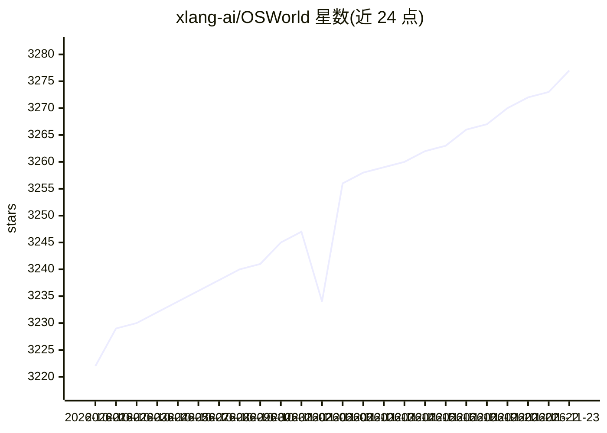

# xlang-ai/OSWorld

⭐ 3,277 · Python · Apache-2.0 · 推送 2026-11-14 · [GitHub](https://github.com/xlang-ai/OSWorld) · [官网](https://os-world.github.io) · 组织维护

**在真实计算机环境中评测多模态 agent 的基准**

OSWorld 提供一个用于评测多模态 agent 在真实操作系统环境中完成开放任务的基准：内置带任务配置的 Ubuntu/Windows 虚拟机环境、agent 与环境两套接口，以及按领域/类别统计成功率的评测脚本。用户可基于 VMware、VirtualBox、Docker、Modal、Daytona 或 AWS 多种 provider 运行环境，支持并行评测与手动任务检查；论文发表于 NeurIPS 2024，面向研究 agent 能力的开发者与科研人员。

## 筛选速览

| 维度 | 判定 | 备注 |
|---|---|---|
| AI 角色 | `ai-ecosystem` | LLM/agent 周边工具 |
| 许可风险 | `permissive` | Apache-2.0 |
| 部署形态 | `library` | 以包/库形式分发 |
| 模型依赖 | — | README 未给出锁定关系 |
| 硬件要求 | — | 无带数字的原话,不猜 |
| 安装摩擦 | `low` | 无编译、无系统依赖或容器化 |
| 成熟度 | — | 结构信号不足 |

## 能力要点

- 提供 VMware/VirtualBox/Docker/Modal/Daytona/AWS 多种虚拟环境 provider
- 任务结果含截图、动作与录像，输出领域级与整体成功率统计
- 提供手动任务检查工具以验证任务正确性与评测指标
- OSWorld-Verified 更新支持 AWS 并行评测，可将评测压缩至 1 小时内

## 适用场景

- 在自己的 agent 上运行基准并对比官方模型结果
- 用 Docker 或 AWS 并行化大规模评测任务
- 手动检查和验证特定基准任务的评测指标

## 场景标签

`模型评测` · 领域:评测与运维

## 证据(README 行号)

> L137: ## 🧪 Experiments
> L216: ## Evaluation
> L223: If you want your results to be verified and displayed on the verified leaderboard, you need to schedule a meeting 

## 星数曲线

2026-10-21 3,222 → 2026-11-23 3,277（+55）

---
*卡片 v1 · prompt 1.4 · 生成 2026-11-23 · 置信度 high · 依据 README sha `f75365e3b6bb` · [字段定义](../../DATASET.md)*
