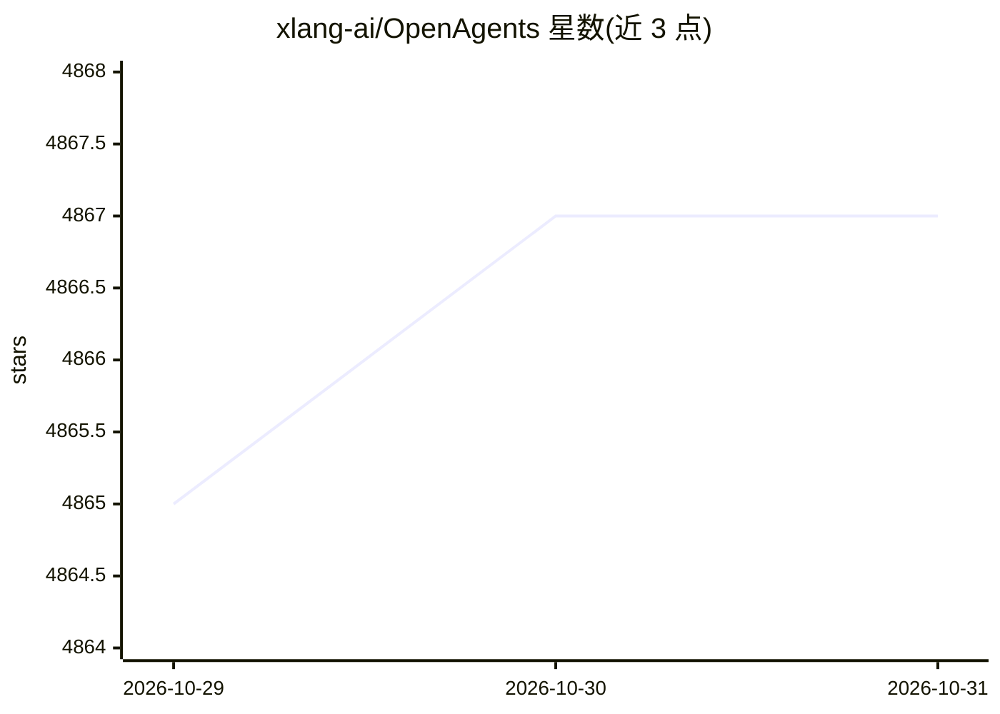

# xlang-ai/OpenAgents

⭐ 4,867 · Python · Apache-2.0 · 推送 2026-10-27 · [GitHub](https://github.com/xlang-ai/OpenAgents) · [官网](https://arxiv.org/abs/2310.10634) · 组织维护

**面向普通用户的语言 Agent 开放平台：数据分析/插件/浏览网页三类 Agent**

COLM 2024 论文配套的开源平台，实现三个可通过 Chat 网页 UI 直接使用的语言 Agent：用 Python/SQL 与数据工具做分析的 Data Agent、集成 200+ 第三方插件的 Plugins Agent（支持多插件并发与自动选插件）、基于 Chrome 扩展自动浏览网页的 Web Agent。普通用户通过在线 Demo 免费使用，开发者可在本地从源码或 docker-compose 部署；后端基于 Flask 与 LangChain 代码构建，支持注册新 Agent、新 LLM 与新插件扩展。Docker 部署标注为开发中状态。

## 筛选速览

| 维度 | 判定 | 备注 |
|---|---|---|
| AI 角色 | `ai-native` | 本体是模型或模型工具 |
| 许可风险 | `permissive` | Apache-2.0 |
| 部署形态 | `self-host` | docker 或自建部署 |
| 模型依赖 | — | README 未给出锁定关系 |
| 硬件要求 | — | 无带数字的原话,不猜 |
| 安装摩擦 | `low` | 无编译、无系统依赖或容器化 |
| 成熟度 | `idea` | |

## 能力要点

- 三个已实现 Agent：数据分析（Python/SQL）、200+ 插件调用、自主网页浏览
- 提供针对快速响应与常见失败的 Chat 网页 UI
- 可扩展新 Agent、新 LLM 后端（API 注册方式）与新插件（ai-plugin.json + openapi.yaml）
- 提供从源码与 docker-compose 两种本地部署方式

## 适用场景

- 通过对话让 Agent 用 Python/SQL 完成数据分析与可视化
- 在购物、天气、科学计算等日常场景中调用并组合 200+ 插件
- 让 Agent 自动操作浏览器完成地图导航、填表、发推等任务
- 研究者本地部署平台做真实场景下的语言 Agent 评估

## 场景标签

`数据分析` `浏览器自动化` · 领域:效率与自动化

## 证据(README 行号)

> L42: We built OpenAgents, an open platform for using and hosting language agents in the wild of everyday life.
> L44: We have now implemented three agents in OpenAgents, and we host them on demo for free use!
> L56: OpenAgents enables general users to interact with agent functionalities through a web UI optimized for swift respon

## 星数曲线

2026-10-29 4,865 → 2026-10-31 4,867（+2）

---
*卡片 v1 · prompt 1.4 · 生成 2026-10-28 · 置信度 high · 依据 README sha `9ba10ed243b5` · [字段定义](../../DATASET.md)*
