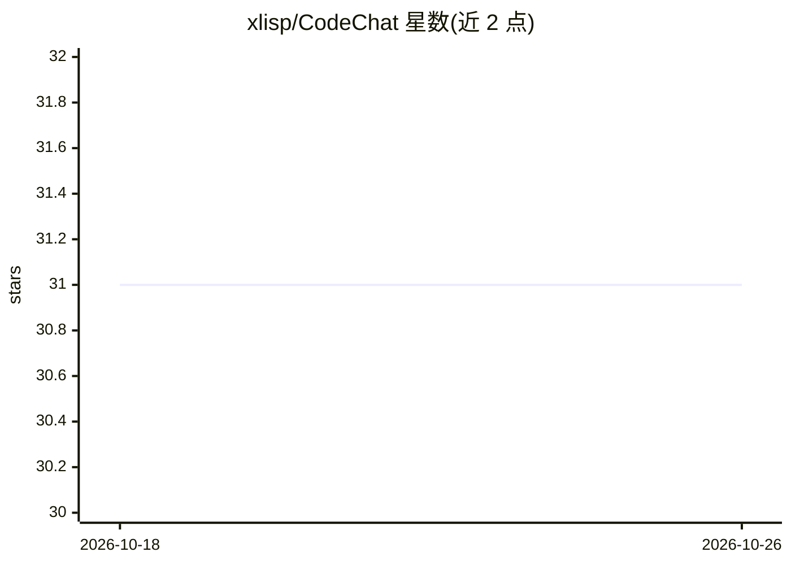

# xlisp/CodeChat

⭐ 31 · Python · 推送 2026-08-19 · [GitHub](https://github.com/xlisp/CodeChat) · 个人维护 · 中文 README

**从零训练 8B 代码对话模型的完整训练方案（8x A800）**

CodeChat 8B 的训练说明仓库：在 8x A800-SXM4-80GB 上用 FSDP FULL_SHARD 分片把模型从 2B（约2.1B参数）放大到约8.3B参数，提供预训练、SFT、基于 GRPO 的 RL（MBPP）五阶段一键脚本，附显存预算分析（每卡峰值约55-65GB）、超参表、续训策略与常见坑清单。另含 function calling 能力的续 SFT 流程（glaive-function-calling-v2 数据集，仅对 assistant 段计 loss）。限制：30k step 约 3.9B tokens，自述仅约 Chinchilla 建议量的 2.4%，非充分预训练；首轮 RL reward 恒 0，README 给出阶梯奖励与题目过滤的修复方案。

## 筛选速览

| 维度 | 判定 | 备注 |
|---|---|---|
| AI 角色 | `ai-native` | 本体是模型或模型工具 |
| 许可风险 | `none` | — |
| 部署形态 | `library` | 以包/库形式分发 |
| 模型依赖 | — | README 未给出锁定关系 |
| 硬件要求 | `gpu-24g` | |
| 安装摩擦 | `medium` | 含编译或系统依赖之一 |
| 成熟度 | — | 结构信号不足 |

## 能力要点

- FSDP FULL_SHARD（等价 ZeRO-3）+ 激活检查点 + bf16 的 8 卡训练方案，每卡峰值约 55-65GB
- 预训练/SFT/RL 五阶段一键脚本，支持 SKIP_TO 续跑
- function calling 续训流程：输出 <functioncall> JSON 调用并对 FUNCTION RESPONSE 总结
- checkpoint 以完整 state_dict 落盘，下游 chat_cli / eval_swebench 无需 FSDP 环境

## 适用场景

- 在多卡 A800 环境从零训练/放大自己的 GPT 式代码模型
- 学习 8B 级模型 FSDP 分片、显存预算与分布式训练工程细节
- 复现代码生成 + function calling + GRPO 强化学习的完整流水线

## 场景标签

`模型训练` `强化学习` · 领域:训练与推理

## 证据(README 行号)

> L20: 本 README 专门介绍在 **8x NVIDIA A800-SXM4-80GB** 上把 CodeChat 从 **2B 升级到 8B** 的这次训练：动机、FSDP 分片方案、显存预算、启动命令、代码改动、续训策略、常见坑。
> L226: ## Function-calling 能力训练 (`train_a800_x8_v2_funcall.sh`)

## 星数曲线

2026-10-18 31 → 2026-10-26 31（+0）

---
*卡片 v1 · prompt 1.4 · 生成 2026-10-26 · 置信度 mid · 依据 README sha `cb942e9f1c15` · [字段定义](../../DATASET.md)*
