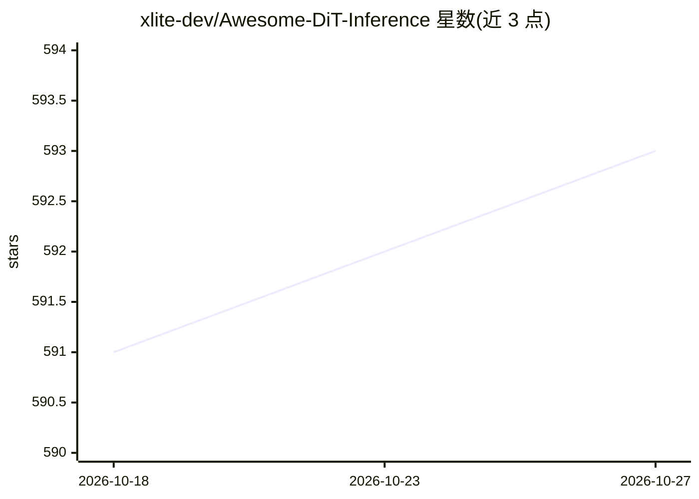

# xlite-dev/Awesome-DiT-Inference

⭐ 593 · Python · GPL-3.0 · 推送 2026-06-13 · [GitHub](https://github.com/xlite-dev/Awesome-DiT-Inference) · 组织维护

**扩散模型推理加速论文与代码的策展清单**

由 xlite-dev 维护的 awesome list，收录扩散模型（DiT）推理加速方向的论文与对应开源代码，按采样（DPM-Solver 系列等）、缓存（DeepCache、TeaCache、cache-dit 等）、并行（DistriFusion、PipeFusion 等）等类别组织成表格，条目含日期、标题、论文链接、代码链接与推荐度标记，并附 BibTeX 引用方式。面向从事扩散模型推理优化研究的开发者与科研人员，仅作索引不含可运行代码。

## 筛选速览

| 维度 | 判定 | 备注 |
|---|---|---|
| AI 角色 | `ai-knowledge` | 知识聚合/清单类 |
| 许可风险 | `viral` | GPL-3.0 |
| 部署形态 | `None` |  |
| 模型依赖 | — | README 未给出锁定关系 |
| 硬件要求 | — | 无带数字的原话,不猜 |
| 安装摩擦 | `low` | 无编译、无系统依赖或容器化 |
| 成熟度 | — | 结构信号不足 |

## 能力要点

- 按 Sampling/Caching/Parallelism 等技术类别组织条目
- 每条含论文链接与代码仓库链接及推荐度标记
- 覆盖 UNet 与 DiT 两条架构路线的加速工作

## 适用场景

- 查找扩散模型采样加速（DPM-Solver 等）的论文与实现
- 调研 DiT 缓存加速方法（DeepCache/TeaCache 等）的代码仓库
- 了解扩散模型分布式并行推理方向的研究进展

## 场景标签

`精选清单` · 领域:学习与行业

## 证据(README 行号)

> L1: 📒A curated list of Awesome **Diffusion** Inference Papers with codes. For Awesome LLM Inference, please check 📖Aweso
> L22: ## 📙 Sampling

## 星数曲线

2026-10-18 591 → 2026-10-27 593（+2）

---
*卡片 v1 · prompt 1.4 · 生成 2026-10-21 · 置信度 high · 依据 README sha `08d3b61292f8` · [字段定义](../../DATASET.md)*
