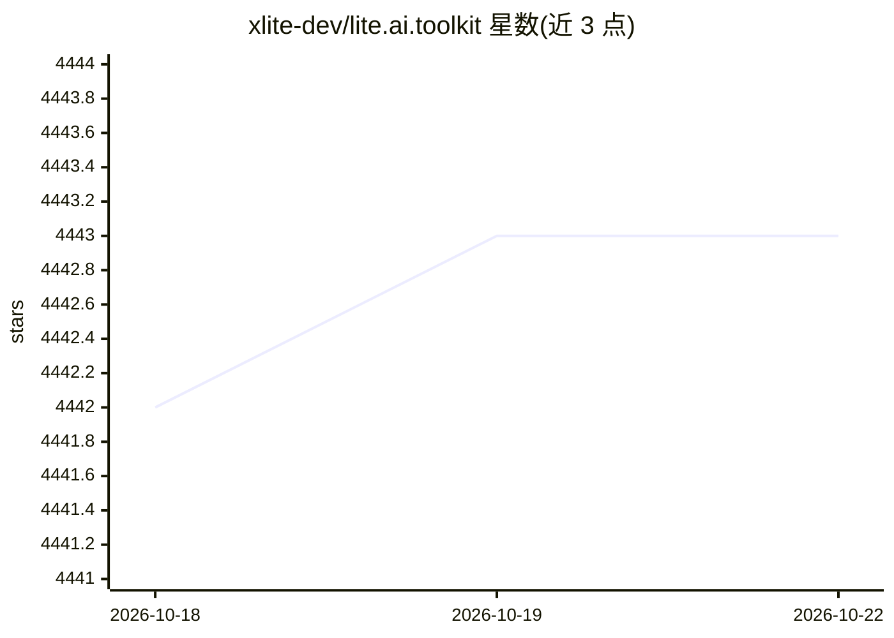

# xlite-dev/lite.ai.toolkit

⭐ 4,443 · C++ · GPL-3.0 · 推送 2026-09-05 · [GitHub](https://github.com/xlite-dev/lite.ai.toolkit) · [官网](https://github.com/xlite-dev/lite.ai.toolkit) · 组织维护 · 中文 README

**C++ AI 推理工具箱：100+ 模型的检测/识别/抠图/生成实现**

轻量级 C++ 工具箱，以一致语法（lite::cv::Type::Class）封装 300+ 个模型 C++ 实现与 500+ 权重，覆盖目标检测、人脸检测/识别/对齐/属性、分割、抠图、风格迁移、着色、超分、Stable-Diffusion 等。支持 ONNXRuntime（默认）、MNN、NCNN、TNN 后端及 TensorRT GPU 推理；默认依赖仅 OpenCV 与 ONNXRuntime。以源码构建（build.sh，Linux）或预编译库形式提供，供开发者集成到 C++ 工程。

## 筛选速览

| 维度 | 判定 | 备注 |
|---|---|---|
| AI 角色 | `ai-native` | 本体是模型或模型工具 |
| 许可风险 | `viral` | GPL-3.0 |
| 部署形态 | `self-host` | docker 或自建部署 |
| 模型依赖 | — | README 未给出锁定关系 |
| 硬件要求 | — | 无带数字的原话,不猜 |
| 安装摩擦 | `low` | 无编译、无系统依赖或容器化 |
| 成熟度 | — | 结构信号不足 |

## 能力要点

- 300+ C++ 实现与 500+ 权重，覆盖检测/人脸/分割/抠图/生成等类别
- 多推理后端：ONNXRuntime（默认）、MNN、NCNN、TNN、TensorRT
- 默认依赖仅 OpenCV 与 ONNXRuntime
- 提供跨平台支持矩阵（Linux/MacOS/Windows，部分 Android 计划中）

## 适用场景

- 在 C++ 工程中集成 YOLOv5 等检测模型
- 构建人脸识别、人脸属性分析应用
- 视频抠图与人像分割处理
- 通过 TensorRT 在 NVIDIA GPU 上加速推理

## 场景标签

`目标检测` `人脸识别` `图像生成` `图像视频处理` · 领域:内容生成

## 证据(README 行号)

> L3: 🛠**Lite.Ai.ToolKit**: A lite C++ toolkit of 100+ Awesome AI models, such as Object Detection, Face Detection, Face R
> L25: * **Many Models Supported.** **300+** C++ implementations and **500+** weights 👉 **Supported-Matrix**.

## 星数曲线

2026-10-18 4,442 → 2026-10-22 4,443（+1）

---
*卡片 v1 · prompt 1.4 · 生成 2026-10-21 · 置信度 mid · 依据 README sha `873c44cf17a3` · [字段定义](../../DATASET.md)*
