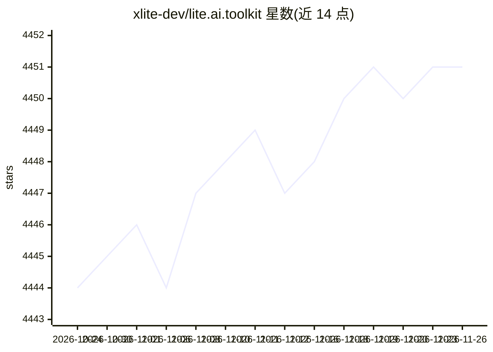

# xlite-dev/lite.ai.toolkit

⭐ 4,451 · C++ · GPL-3.0 · 推送 2026-11-18 · [GitHub](https://github.com/xlite-dev/lite.ai.toolkit) · [官网](https://github.com/xlite-dev/lite.ai.toolkit) · 个人维护 · 中文 README

**给 C++ 开发者的 100+ 视觉 AI 模型推理工具包**

一个 C++ AI 模型推理工具包，将 300+ 个模型的 C++ 实现与 500+ 份预训练权重封装为统一的 lite::cv::Type::Class 语法，覆盖目标检测、人脸检测/识别/对齐/属性、分割、抠图、风格迁移、上色、超分、Stable Diffusion、FaceFusion 等。默认仅依赖 OpenCV 与 ONNXRuntime，可选启用 MNN、NCNN、TNN、TensorRT 后端，提供预编译库下载与源码构建（build.sh，v0.2.0 起仅支持 Linux，在 Ubuntu 20.04.6 测试），当前主要由 @wangzijian1010 维护。

## 筛选速览

| 维度 | 判定 | 备注 |
|---|---|---|
| AI 角色 | `ai-native` | 本体是模型或模型工具 |
| 许可风险 | `viral` | GPL-3.0 |
| 部署形态 | `self-host` | docker 或自建部署 |
| 模型依赖 | — | README 未给出锁定关系 |
| 硬件要求 | — | 无带数字的原话,不猜 |
| 安装摩擦 | `low` | 无编译、无系统依赖或容器化 |
| 成熟度 | — | 结构信号不足 |

## 能力要点

- 统一 lite::cv::Type::Class 语法的 300+ 模型 C++ 实现
- 默认仅依赖 OpenCV 与 ONNXRuntime
- 支持 TensorRT（需 TensorRT 10.x+ 与 CUDA 12.x+）、MNN、NCNN、TNN 多后端
- 提供预编译库与测试资源下载（tag/v0.2.0）

## 适用场景

- 在 C++ 项目中运行 YOLO 系列目标检测
- 离线执行人脸识别、对齐与年龄/性别/情绪属性分析
- 人像/头发抠图与背景移除
- CPU 或 NVIDIA GPU 上部署分割与风格迁移模型

## 场景标签

`图像生成` `人脸识别` `目标检测` `图像视频处理` · 领域:内容生成

## 证据(README 行号)

> L3: 🛠**Lite.Ai.ToolKit**: A lite C++ toolkit of 100+ Awesome AI models, such as Object Detection, Face Detection, Face R
> L20: * **Minimum Dependencies.** Only **OpenCV** and **ONNXRuntime** are required by default, see build.
> L64: The goal of lite.ai.toolkit is not to abstract on top of MNN and ONNXRuntime. So, you can use lite.ai.toolkit mixed

## 星数曲线

2026-10-24 4,444 → 2026-11-26 4,451（+7）

---
*卡片 v1 · prompt 1.4 · 生成 2026-11-22 · 置信度 mid · 依据 README sha `e5c8f8f78f9b` · [字段定义](../../DATASET.md)*
