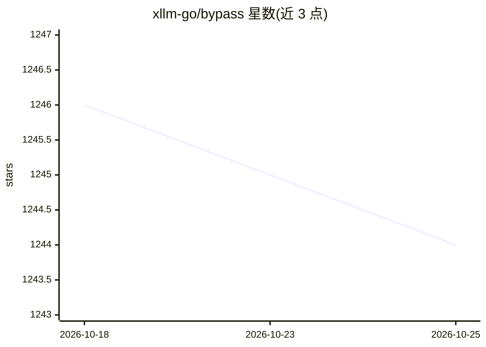

# xllm-go/bypass

⭐ 1,244 · Go · GPL-3.0 · 推送 2026-06-24 · [GitHub](https://github.com/xllm-go/bypass) · [官网](https://xllm-go.github.io/bypass) · 个人维护 · 中文 README

**将多款 AI 聊天逆向接口适配为 OpenAI 标准接口的服务端**

用 Go 编写、自部署的 API 适配服务端：把 coze 国际版、new bing copilot、cursor、windsurf、qodo、deepseek、LMSYS Chatbot Arena、you、grok、huggingface 绘图等多款 AI 的聊天逆向接口统一转换为 OpenAI v1 兼容接口，支持高速流式输出与多轮对话，供已有 OpenAI 客户端调用。通过 go install/make 构建运行，或用 Docker 镜像与 systemctl 启动。README 声明仅用于测试和学习研究、禁止商业用途，并要求下载后 24 小时内删除。

## 筛选速览

| 维度 | 判定 | 备注 |
|---|---|---|
| AI 角色 | `ai-ecosystem` | LLM/agent 周边工具 |
| 许可风险 | `viral` | GPL-3.0 |
| 部署形态 | `desktop` | 安装包/桌面程序 |
| 模型依赖 | locked-api |  |
| 硬件要求 | — | 无带数字的原话,不猜 |
| 安装摩擦 | `low` | 无编译、无系统依赖或容器化 |
| 成熟度 | — | 结构信号不足 |

## 能力要点

- 十余款 AI 聊天接口统一转为 OpenAI v1 兼容格式
- 支持高速流式输出与多轮对话
- 提供 Docker 镜像（ghcr.io）与 systemctl 自启动配置

## 适用场景

- 让仅支持 OpenAI API 的客户端调用其他 AI 服务
- 在本机或 VPS 统一代理多家 AI 聊天接口

## 场景标签

`模型网关` · 领域:Agent 开发

## 证据(README 行号)

> L3: 该服务集成了openai-api、coze、deepseek、cursor、windsurf、blackbox、you、grok、bing 绘画 多款AI的聊天逆向接口适配到 OpenAI API 标准接口服务端。
> L9: 支持高速流式输出、支持多轮对话，与ChatGPT接口完全兼容。
> L11: 使用本项目，可享用以下内容转v1接口：

## 星数曲线

2026-10-18 1,246 → 2026-10-25 1,244（-2）

---
*卡片 v1 · prompt 1.4 · 生成 2026-10-21 · 置信度 high · 依据 README sha `de492911e3cb` · [字段定义](../../DATASET.md)*
