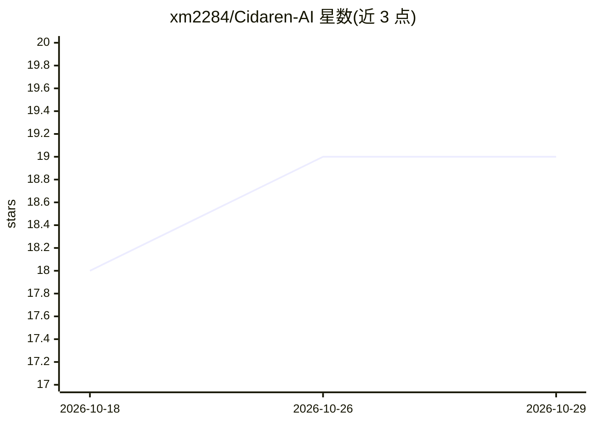

# xm2284/Cidaren-AI

⭐ 19 · Python · MIT · 推送 2026-10-05 · [GitHub](https://github.com/xm2284/Cidaren-AI) · 个人维护 · 中文 README

**词达人班级任务自动答题脚本，AI 大模型选题作答**

基于 moningf/cidaren 二次开发的 Python 脚本，自动完成词达人（vocabgo）班级任务：拉取任务列表、自动获取候选单词列表（ChoseWordList API），将题目与候选词发送至 OpenAI 兼容 API 由大模型选词作答，AI 失败时回退空白试探法。修复原版 8 个 Bug（过期任务过滤、重试超时、GBK 终端兼容等）。需用 Fiddler 抓取 UserToken 配置后运行，纯标准库无第三方依赖。

## 筛选速览

| 维度 | 判定 | 备注 |
|---|---|---|
| AI 角色 | `ai-native` | 本体是模型或模型工具 |
| 许可风险 | `permissive` | MIT |
| 部署形态 | `None` |  |
| 模型依赖 | — | README 未给出锁定关系 |
| 硬件要求 | — | 无带数字的原话,不猜 |
| 安装摩擦 | `low` | 无编译、无系统依赖或容器化 |
| 成熟度 | — | 结构信号不足 |

## 能力要点

- AI 优先答题 + 空白试探兜底的双路径机制
- 自动获取任务单词列表，AI 从候选词中选词
- 纯 Python 标准库，无第三方依赖，跨平台
- 支持全自动/交互/指定任务 ID 等多种运行模式

## 适用场景

- 自动完成词达人班级任务并控制答题间隔
- 通过 AI 从候选词列表中选词作答
- 仅校验 Token 有效性或排查任务状态

## 场景标签

`工作流自动化` · 领域:效率与自动化

## 证据(README 行号)

> L27: Cidaren-AI 基于 moningf/cidaren 二次开发，针对原版及社区常见分支存在的 8 个关键 Bug 逐一修复，并集成 **AI 大模型答题** 与 **自动获取单词列表** 功能，使答题正确率大幅提升。
> L54: 1. AI 优先答题
> L55:    题目内容 + 任务单词列表 → 大模型 API → 结构化答案

## 星数曲线

2026-10-18 18 → 2026-10-29 19（+1）

---
*卡片 v1 · prompt 1.4 · 生成 2026-10-28 · 置信度 high · 依据 README sha `52f25b8cbd44` · [字段定义](../../DATASET.md)*
