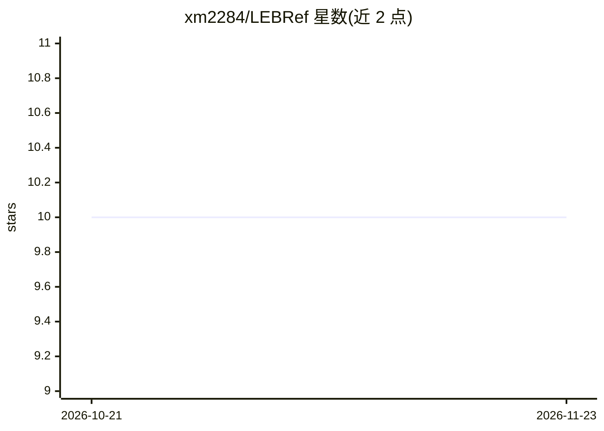

# xm2284/LEBRef

⭐ 10 · Python · MIT · 推送 2026-10-05 · [GitHub](https://github.com/xm2284/LEBRef) · 个人维护

**腕戴式跌倒检测研究 LEBRef 的复现代码包**

论文《LEBRef: Linear Event-Bag Refinement for Continuous Wrist-Worn Fall Detection》的公开复现配套仓库：将下游监督重组为事件袋与主体平衡的背景占用，用于连续腕戴跌倒监测。提供 V6 锁定评估协议代码、V9 主实验训练代码（Probe / Event-MIL / LEBRef）、V19 免再训练诊断脚本，以及 SmartFallMM 与 UMAFall 主体无关评估的已发布摘要结果。原始数据集与 checkpoints 因许可与体积未随仓库分发，训练需按文档自行获取。

## 筛选速览

| 维度 | 判定 | 备注 |
|---|---|---|
| AI 角色 | `ai-native` | 本体是模型或模型工具 |
| 许可风险 | `permissive` | MIT |
| 部署形态 | `library` | 以包/库形式分发 |
| 模型依赖 | — | README 未给出锁定关系 |
| 硬件要求 | — | 无带数字的原话,不猜 |
| 安装摩擦 | `low` | 无编译、无系统依赖或容器化 |
| 成熟度 | — | 结构信号不足 |

## 能力要点

- 提供 V6 锁定评估协议与 V9 主实验训练代码
- V19 免再训练诊断：负袋梯度、年龄组、运动强度、告警段 PR/Recall-Duty 曲线
- results/released_summary 提供无需私有数据即可查阅的摘要结果
- 提供论文到仓库的映射说明（docs/MANUSCRIPT_MAPPING.md）

## 适用场景

- 复现论文在 SmartFallMM/UMAFall 上的主体无关评估结果
- 研究腕戴跌倒检测中的监督精炼方法
- 运行免再训练诊断分析已训练模型的告警行为

## 场景标签

`科研工具` · 领域:学习与行业

## 证据(README 行号)

> L7: LEBRef is a supervision-refinement method for continuous wrist-worn fall
> L11: locked evaluation protocols, and released summary results for the fixed
> L97: This repository is the public code and reproducibility companion for the

## 星数曲线

2026-10-21 10 → 2026-11-23 10（+0）

---
*卡片 v1 · prompt 1.4 · 生成 2026-11-19 · 置信度 high · 依据 README sha `8c12407237bc` · [字段定义](../../DATASET.md)*
