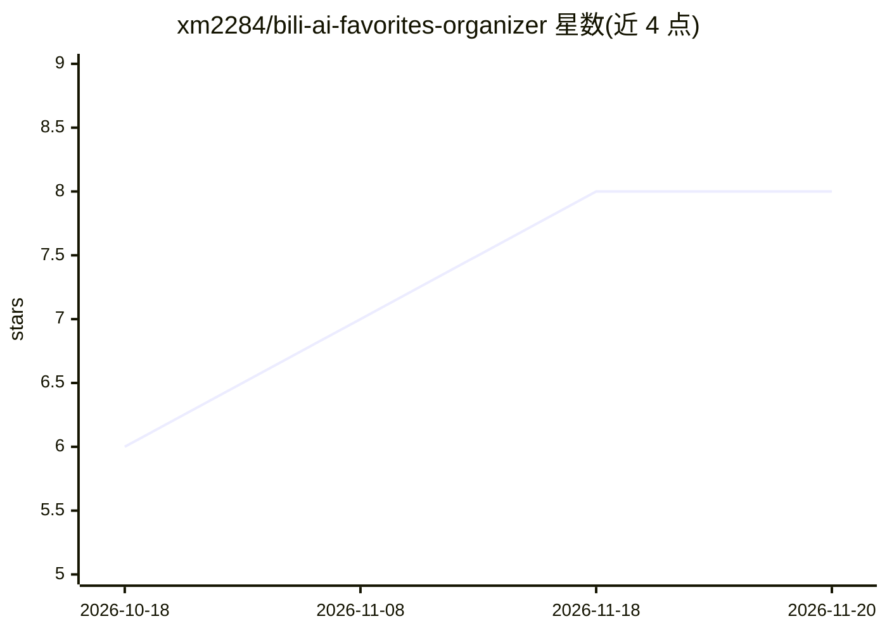

# xm2284/bili-ai-favorites-organizer

⭐ 8 · Svelte · NOASSERTION · 推送 2026-11-04 · [GitHub](https://github.com/xm2284/bili-ai-favorites-organizer) · [官网](https://raw.githubusercontent.com/xm2284/bili-ai-favorites-organizer/main/dist/bilibili-ai-favorites-organizer-pro.user.js) · 个人维护 · 中文 README

**B站用户的油猴脚本：AI 自动分类整理收藏夹**

运行在 Tampermonkey 上的 Bilibili 收藏夹整理脚本，读取视频的标题、UP主与简介，调用大模型做语义分类，把一个收藏夹的视频拆分归入多个收藏夹。支持 DeepSeek 等 12 家以上服务商接入，另有无需 API Key 的本地关键词规则分类。执行前提供两阶段预览确认，附带失效视频归档、查重去重、备份恢复、撤销历史等功能。需浏览器安装 Tampermonkey 扩展；本仓库为 madoka-chann 原项目的二次开发增强版。

## 筛选速览

| 维度 | 判定 | 备注 |
|---|---|---|
| AI 角色 | `ai-native` | 本体是模型或模型工具 |
| 许可风险 | `none` | NOASSERTION |
| 部署形态 | `library` | 以包/库形式分发 |
| 模型依赖 | local-ok | 支持本地模型 |
| 硬件要求 | — | 无带数字的原话,不猜 |
| 安装摩擦 | `low` | 无编译、无系统依赖或容器化 |
| 成熟度 | — | 结构信号不足 |

## 能力要点

- AI 深度分类：标题+UP主+简介交给大模型判断，另有完全离线的本地关键词规则模式
- 两阶段预览确认：先展示分类方案，确认后才移动视频
- 多服务商支持：DeepSeek / 硅基流动 / Gemini / OpenAI / 通义千问 / Ollama / Anthropic 等
- 失效视频归档、跨收藏夹查重/去重、备份恢复与撤销历史

## 适用场景

- 把积攒了大量视频的 B 站大收藏夹自动拆分到多个主题收藏夹
- 不想申请 API Key 时用本地关键词规则离线归类
- 整理前先预览方案、可手动增删改合并后再执行
- 用备份/撤销机制保证整理操作可回退

## 场景标签

`工作流自动化` · 领域:效率与自动化

## 证据(README 行号)

> L9: > 一款运行在浏览器（油猴 / Tampermonkey）上的 Bilibili 收藏夹 AI 智能分类整理助手。把一个杂乱的大收藏夹，自动拆分归类到多个清晰的收藏夹中。
> L95: - **AI 深度分类**：综合标题、UP 主、简介摘要交给大模型判断。
> L98: - **多 AI 服务商**：DeepSeek / 硅基流动 / Gemini / OpenAI / 通义千问 / Kimi / 智谱 / Groq / OpenRouter / Ollama / GitHub Models / 

## 星数曲线

2026-10-18 6 → 2026-11-20 8（+2）

---
*卡片 v1 · prompt 1.4 · 生成 2026-11-20 · 置信度 high · 依据 README sha `d09f46c4802e` · [字段定义](../../DATASET.md)*
