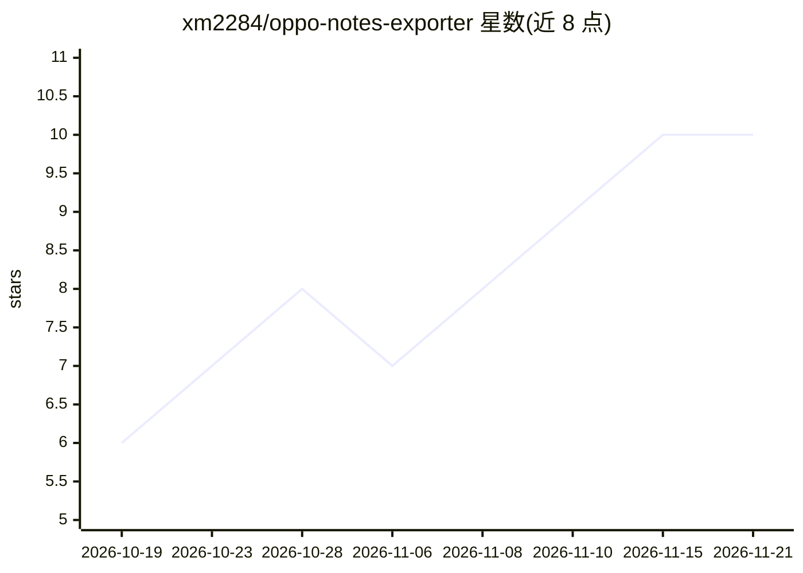

# xm2284/oppo-notes-exporter

⭐ 10 · JavaScript · MIT · 推送 2026-10-05 · [GitHub](https://github.com/xm2284/oppo-notes-exporter) · [官网](https://github.com/xm2284/oppo-notes-exporter#readme) · 个人维护 · 中文 README

**OPPO/一加便签全量导出工具：一键导出 Markdown/CSV/JSON**

针对 OPPO 云服务（ColorOS 随身工作台）便签无批量导出入口的问题，通过 Chrome DevTools Protocol 挂钩宿主浏览器运行时上下文，捕获解密后的明文笔记数据；驱动虚拟滚轮懒加载并逐篇打开详情获取完整长正文，导出为 notes.json、Excel 兼容的 CSV 以及单文件与逐篇（含 YAML Frontmatter）两种 Markdown。凭扫码/短信登录，本地只读运行、无需输入账号密码。需 Node.js ≥18 与本地 Edge/Chrome，以 CLI 形式从源码克隆运行。

## 筛选速览

| 维度 | 判定 | 备注 |
|---|---|---|
| AI 角色 | `ai-enhanced` | 去掉 AI 部分产品仍成立 |
| 许可风险 | `permissive` | MIT |
| 部署形态 | `None` |  |
| 模型依赖 | — | README 未给出锁定关系 |
| 硬件要求 | — | 无带数字的原话,不猜 |
| 安装摩擦 | `low` | 无编译、无系统依赖或容器化 |
| 成熟度 | — | 结构信号不足 |

## 能力要点

- 经 CDP 捕获 AES-CBC 加密传输层下已解密的明文数据
- 虚拟滚轮懒加载突破列表分页与预览截断，获取 100% 完整正文
- 导出 Markdown/CSV/JSON 三种格式，Markdown 含 Frontmatter 可直接用于 Obsidian
- 只读沙箱运行，无需脚本内输入账号密码

## 适用场景

- 换机时备份 OPPO/一加手机上的全部便签
- 把多年笔记迁移到 Obsidian/Notion/Logseq 知识库
- 整理个人笔记作为大模型知识库素材
- 本地离线归档便签内容

## 场景标签

`浏览器自动化` `网页抓取` · 领域:效率与自动化

## 证据(README 行号)

> L9:  一键将 OPPO / 一加 (OnePlus / ColorOS 随身工作台) 中的全部便签导出为 Markdown、CSV 与 JSON。
> L32:  OPPO 云笔记传输层采用 AES-CBC 动态加解密并附加时间戳签名防重放。传统爬虫极难维护且随时失效。本项目通过 **Chrome DevTools Protocol (CDP)** 挂钩宿主浏览器运行时上下文，直接捕获已解
> L49: - Node.js (>= 18.0.0)

## 星数曲线

2026-10-19 6 → 2026-11-21 10（+4）

---
*卡片 v1 · prompt 1.4 · 生成 2026-11-19 · 置信度 high · 依据 README sha `28323df4febd` · [字段定义](../../DATASET.md)*
