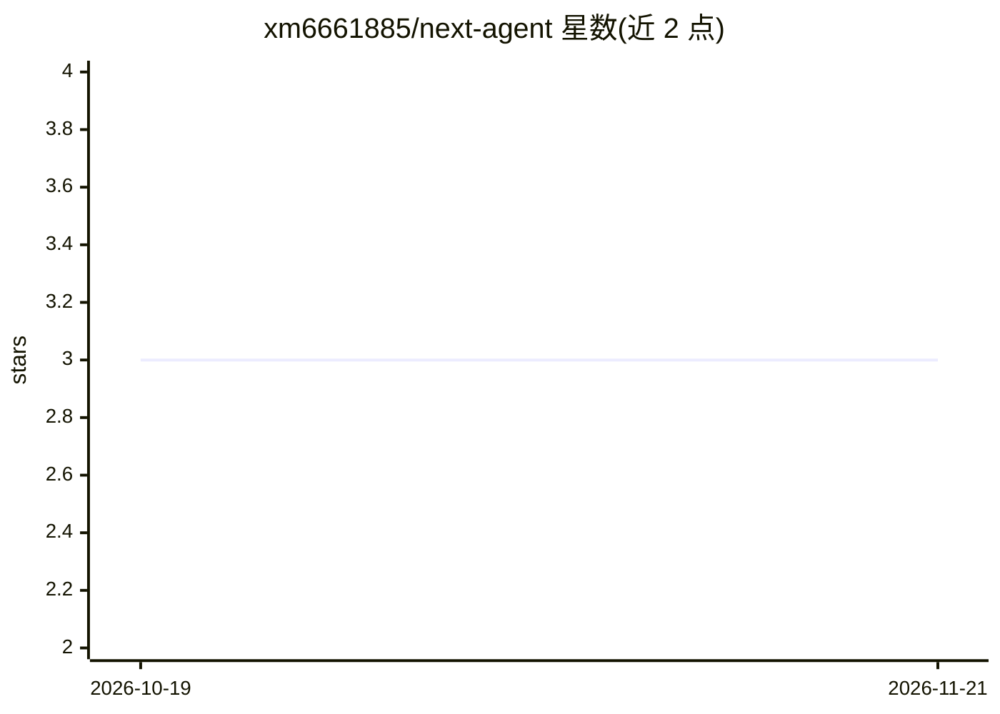

# xm6661885/next-agent

⭐ 3 · TypeScript · 推送 2026-11-06 · [GitHub](https://github.com/xm6661885/next-agent) · 个人维护

**自托管 Claude Code 持久化 Agent 的 Web 控制台与 PWA**

基于 Claude Agent SDK（FastAPI + Preact）的自托管控制台，从手机或桌面浏览器管理持久化 Claude Code agent。四个标签页分别提供 LLM 聊天、Agent 管理（工作目录/模型/权限/MCP/子代理等设置、流式工具卡片、审批、fork 与 rewind、浏览器关闭后会话继续运行）、经 Agent Client Protocol 接入的外部 agent，以及卡片式工作流编辑器。内置 MCP 服务器提供定时任务、会话历史搜索、子代理协作等能力。部署需 Linux/macOS、Python 3.10+、Node.js 18+ 与 Claude Code 凭据。

## 筛选速览

| 维度 | 判定 | 备注 |
|---|---|---|
| AI 角色 | `ai-ecosystem` | LLM/agent 周边工具 |
| 许可风险 | `none` | — |
| 部署形态 | `None` |  |
| 模型依赖 | locked-api |  |
| 硬件要求 | — | 无带数字的原话,不猜 |
| 安装摩擦 | `low` | 无编译、无系统依赖或容器化 |
| 成熟度 | — | 结构信号不足 |

## 能力要点

- 持久化 Claude Code agent：流式工具卡片、审批卡片、fork/rewind，浏览器关闭后会话继续
- 经 Agent Client Protocol（TCP）接入外部 agent，会话流式且断连可续
- 内置 MCP 服务器：cron/一次性定时任务、历史会话搜索、子代理协作窗口
- 卡片式工作流编辑器，卡片以普通 Agent 会话方式运行

## 适用场景

- 在自建服务器上集中管理多个 Claude Code agent 会话
- 用手机浏览器随时查看和续接长时间运行的 agent 任务
- 为 agent 配置 cron 定时任务与子代理协作
- 把多个 MCP 服务器按助手粒度开关并编排成工作流

## 场景标签

`工作流自动化` `AI 助手` · 领域:效率与自动化

## 证据(README 行号)

> L3: A self-hosted web console and PWA for AI agents. It has four bottom tabs: **Chat**, **Agents**, **Workflow** and **M
> L14: - **Agents (Claude):** persistent Claude Code agents through the Agent SDK.

## 星数曲线

2026-10-19 3 → 2026-11-21 3（+0）

---
*卡片 v1 · prompt 1.4 · 生成 2026-11-21 · 置信度 high · 依据 README sha `7aff9390e8c8` · [字段定义](../../DATASET.md)*
