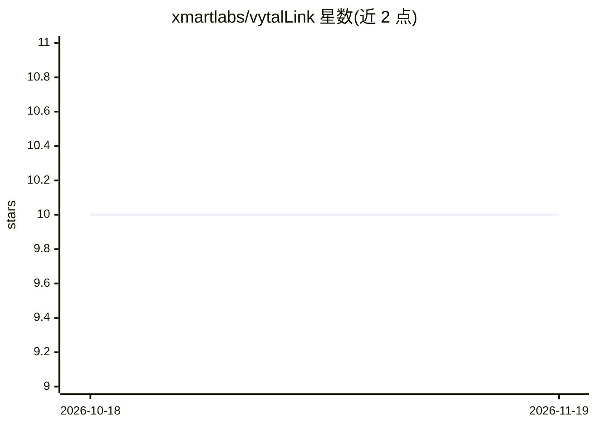

# xmartlabs/vytalLink

⭐ 10 · Dart · MIT · 推送 2026-04-16 · [GitHub](https://github.com/xmartlabs/vytalLink) · [官网](https://vytallink.xmartlabs.com) · 组织维护

**把 Apple Health/Google Fit 健康数据经 MCP 接入 AI 助手**

VytalLink 是一个 monorepo 数字健康项目：从 Apple HealthKit 或 Google Health Connect 采集个人健康数据，通过 MCP 兼容接口暴露，供 AI 助手在用户设备上安全查询。仓库包含 Flutter 移动应用（内嵌 MCP 服务器）、独立 Node.js MCP 服务器、Firebase 部署的静态落地页、TypeScript/Python agent 示例及文档。项目最初为自带本地 MCP 服务器的应用，后转向云托管 MCP 服务器支持的 GPT 集成，应用保留为两者之间的桥接；1.0.0 标签仍保留本地 MCP 服务器版本。强调隐私与用户控制。

## 筛选速览

| 维度 | 判定 | 备注 |
|---|---|---|
| AI 角色 | `ai-ecosystem` | LLM/agent 周边工具 |
| 许可风险 | `permissive` | MIT |
| 部署形态 | `None` |  |
| 模型依赖 | — | README 未给出锁定关系 |
| 硬件要求 | — | 无带数字的原话,不猜 |
| 安装摩擦 | `low` | 无编译、无系统依赖或容器化 |
| 成熟度 | `idea` | |

## 能力要点

- 通过 MCP 接口向 AI 助手暴露 Apple HealthKit / Google Health Connect 数据
- monorepo 含 Flutter 应用、独立 Node.js MCP 服务器、Firebase 落地页与 TS/Python agent 示例
- 提供 llms.txt 面向 AI 的产品与 API 概览
- 保留 1.0.0 本地 MCP 服务器版本

## 适用场景

- 让 AI 助手查询我的 Apple Health 健康指标
- 用 TypeScript 或 Python agent 示例接入 MCP 服务器
- 自托管 Node.js MCP 服务器对外提供健康数据接口

## 场景标签

 · 领域:数字健康/数据接入

## 证据(README 行号)

> L3: VytalLink brings your personal health metrics to life by collecting Apple HealthKit or Google Health Connect data an
> L9: - **mobile/** — Flutter application that runs on device and exposes the embedded MCP server.
> L11: - **mcp-server/** — Standalone MCP server (Node.js) intended to run outside the mobile app.

## 星数曲线

2026-10-18 10 → 2026-11-19 10（+0）

---
*卡片 v1 · prompt 1.4 · 生成 2026-11-19 · 置信度 high · 依据 README sha `b79bd3f146c4` · [字段定义](../../DATASET.md)*
