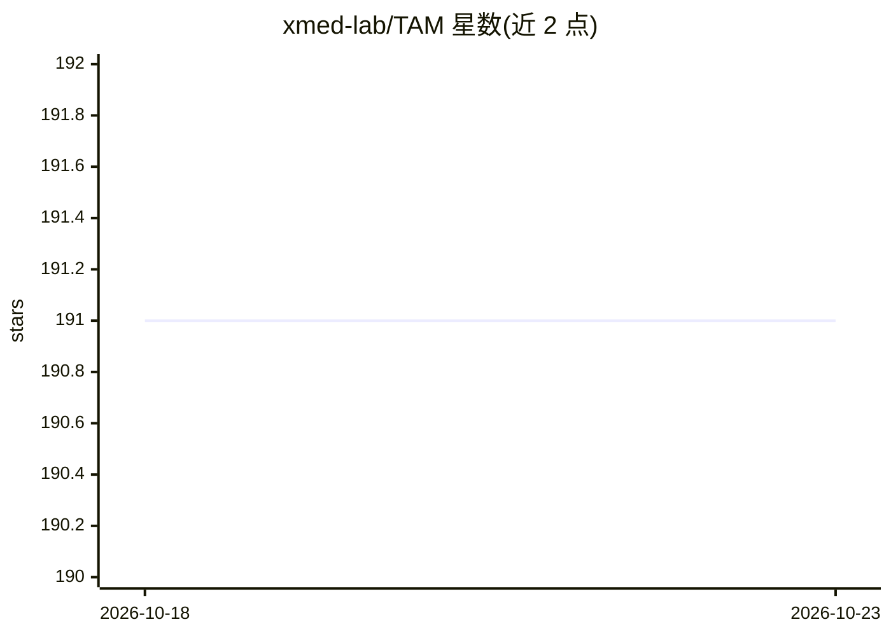

# xmed-lab/TAM

⭐ 191 · Python · 推送 2025-12-14 · [GitHub](https://github.com/xmed-lab/TAM) · 组织维护

**ICCV25 论文方法：可视化解释多模态 LLM 的 Token 激活图**

ICCV 2025 Oral 论文官方代码库，实现 Token Activation Map（TAM）方法：针对多模态 LLM 生成文本的每个 token，计算其依赖的视觉证据并输出可视化结果，含因果推断估计模块与秩高斯滤波模块。提供 demo 脚本（支持图像与视频输入）、在 COCO14/GranDf/OpenPSG 数据集上的定量评测脚本，以及接入自定义 transformers 模型的四步流程。安装依赖 pip requirements 与 texlive-xetex（文本可视化用）。

## 筛选速览

| 维度 | 判定 | 备注 |
|---|---|---|
| AI 角色 | `ai-native` | 本体是模型或模型工具 |
| 许可风险 | `none` | — |
| 部署形态 | `library` | 以包/库形式分发 |
| 模型依赖 | — | README 未给出锁定关系 |
| 硬件要求 | — | 无带数字的原话,不猜 |
| 安装摩擦 | `medium` | 含编译或系统依赖之一 |
| 成熟度 | — | 结构信号不足 |

## 能力要点

- 按生成 token 计算视觉证据激活图并可视化
- demo 脚本支持图像与视频输入
- 提供 COCO14+GranDf+OpenPSG 定量评测
- 四步接入自定义 transformers 多模态模型

## 适用场景

- 可视化检查多模态 LLM 回答所依据的图像区域
- 论文结果的定量复现与评测
- 为自有 MLLM 添加 token 级视觉归因分析

## 场景标签

 · 领域:可解释 AI/多模态 LLM

## 证据(README 行号)

> L1: # Token Activation Map to Visually Explain Multimodal LLMs
> L2: [ICCV 2025 Oral] We introduce the Token Activation Map (TAM), a groundbreaking method that cuts through the contextu
> L53: * Step4: run TAM() to vis each token

## 星数曲线

2026-10-18 191 → 2026-10-23 191（+0）

---
*卡片 v1 · prompt 1.4 · 生成 2026-10-22 · 置信度 high · 依据 README sha `4ec029ce808a` · [字段定义](../../DATASET.md)*
