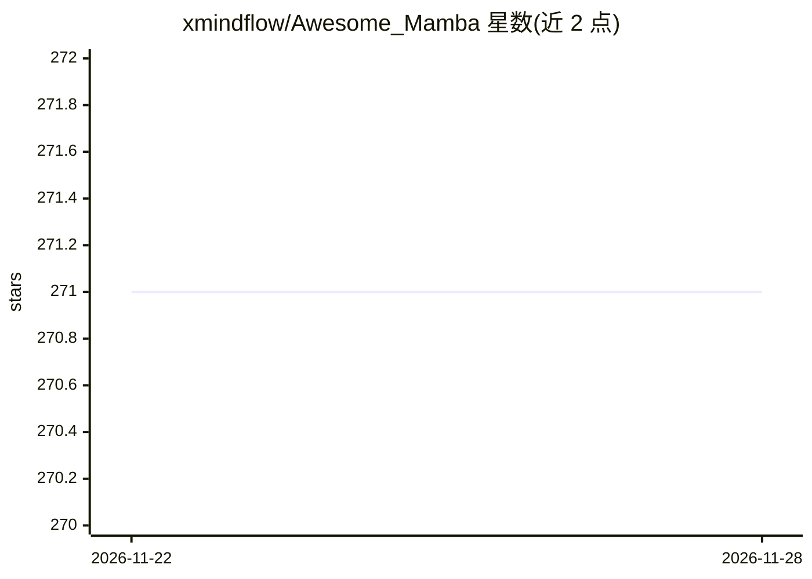

# xmindflow/Awesome_Mamba

⭐ 271 · MIT · 推送 2026-11-21 · [GitHub](https://github.com/xmindflow/Awesome_Mamba) · 组织维护

**医学图像分析领域的 Mamba 状态空间模型论文集合**

围绕论文《Computation-Efficient Era: A Comprehensive Survey of State Space Models in Medical Image Analysis》整理的文献清单，提供 arXiv 链接与 BibTeX 引用条目。条目按类别组织：综述、状态空间模型基础、架构重设计、遥感、语音、视频、图像增强、生成、医学影像、分割、强化学习、NLP、3D 重建与多模态等，每条附论文标题并多附 GitHub 链接。以 MIT 许可发布，首次发布于 2024 年 6 月 5 日。

## 筛选速览

| 维度 | 判定 | 备注 |
|---|---|---|
| AI 角色 | `ai-knowledge` | 知识聚合/清单类 |
| 许可风险 | `permissive` | MIT |
| 部署形态 | `None` |  |
| 模型依赖 | — | README 未给出锁定关系 |
| 硬件要求 | — | 无带数字的原话,不猜 |
| 安装摩擦 | `low` | 无编译、无系统依赖或容器化 |
| 成熟度 | — | 结构信号不足 |

## 能力要点

- 以医学图像分析为重点的 Mamba 相关论文集合
- 按十余个研究领域分类组织条目
- 提供配套综述论文的 arXiv 链接与 BibTeX 引用
- 多数条目附对应 GitHub 仓库链接

## 适用场景

- 查找医学图像分割/分类方向的 Mamba 相关论文
- 调研状态空间模型在各领域的应用进展
- 撰写综述时检索 SSM 文献线索

## 场景标签

`精选清单` · 领域:学习与行业

## 证据(README 行号)

> L6: :fire::fire: This is a collection of awesome articles about Mamba models (With a particular emphasis on Medical Imag
> L8: - Our survey paper on arXiv: Computation-Efficient Era: A Comprehensive Survey of State Space Models in Medical Imag
> L114: ## Medical Imaging

## 星数曲线

2026-11-22 271 → 2026-11-28 271（+0）

---
*卡片 v1 · prompt 1.4 · 生成 2026-11-22 · 置信度 high · 依据 README sha `80fe2845e300` · [字段定义](../../DATASET.md)*
