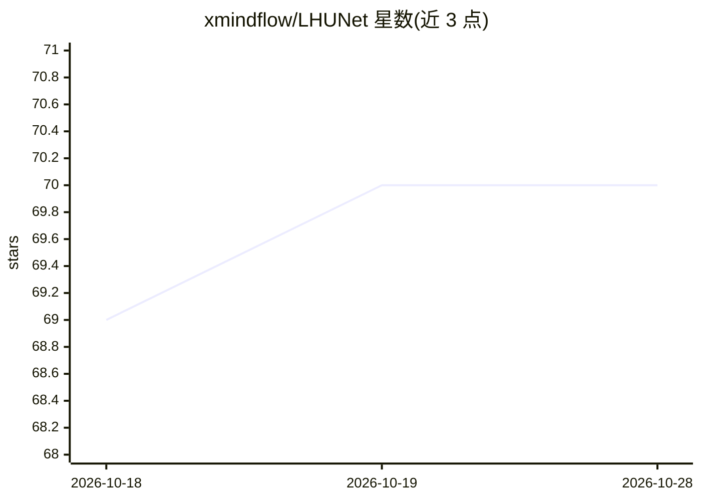

# xmindflow/LHUNet

⭐ 70 · Python · Apache-2.0 · 推送 2026-01-30 · [GitHub](https://github.com/xmindflow/LHUNet) · [官网](https://arxiv.org/abs/2404.05102) · 组织维护

**三维医学图像分割的混合 CNN-Transformer U-Net 模型实现**

MICCAI 2025 论文 LHU-Net 的官方实现：基于层级 U-Net 编码器-解码器结构，结合卷积块与混合注意力机制做 3D 医学图像（CT/MRI）分割。在 Synapse、Left Atrial、BraTS-Decathlon、Lung-Decathlon 四个数据集上评估，模型平均 1,100 万参数，提供预训练权重与预处理数据集下载。基于 nnUNetV2 框架构建，用 env_creation.sh 创建 Conda 环境并安装依赖，训练与推理用预置 shell 脚本，需 Ubuntu 22.04+、CUDA 12.x、建议 8GB+ 显存 GPU（实验用 A100-80G）。另提供 DSC/HD95 指标计算脚本。

## 筛选速览

| 维度 | 判定 | 备注 |
|---|---|---|
| AI 角色 | `ai-native` | 本体是模型或模型工具 |
| 许可风险 | `permissive` | Apache-2.0 |
| 部署形态 | `None` |  |
| 模型依赖 | — | README 未给出锁定关系 |
| 硬件要求 | — | 无带数字的原话,不猜 |
| 安装摩擦 | `medium` | 含编译或系统依赖之一 |
| 成熟度 | — | 结构信号不足 |

## 能力要点

- CNN+Transformer 混合注意力架构，平均 1,100 万参数
- 四个基准数据集的预训练权重与预处理数据下载
- 基于 nnUNetV2 框架，一键脚本创建环境
- 提供 DSC 与 HD95 指标计算脚本

## 适用场景

- 在 CT/MRI 体积数据上做器官或病灶分割
- 复现论文在 Synapse/BraTS 等数据集上的实验结果
- 以较少参数量的模型做医学图像分割研究

## 场景标签

`目标检测` · 领域:感知与多模态

## 证据(README 行号)

> L5: This repository contains the official implementation of **LHU-Net**. Our paper, *"LHU-Net: A Lean Hybrid U-Net for C
> L25: The rise of Transformer architectures has advanced medical image segmentation, leading to hybrid models that combin
> L75: This section provides instructions on how to run **LHU-Net** for your segmentation tasks. It is built using **nnUNe

## 星数曲线

2026-10-18 69 → 2026-10-28 70（+1）

---
*卡片 v1 · prompt 1.4 · 生成 2026-10-24 · 置信度 high · 依据 README sha `0c9bb6395be8` · [字段定义](../../DATASET.md)*
