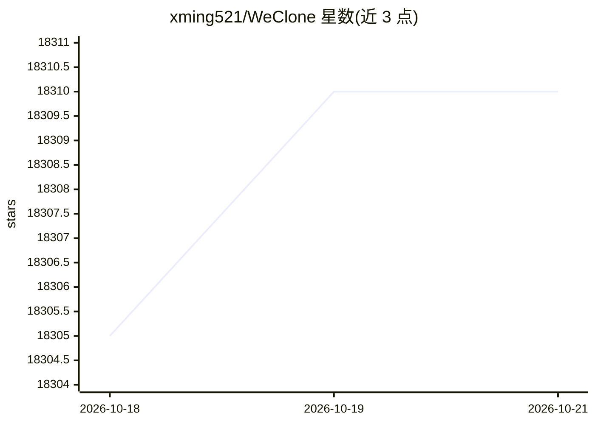

# xming521/WeClone

⭐ 18,310 · Python · AGPL-3.0 · 推送 2026-10-18 · [GitHub](https://github.com/xming521/WeClone) · [官网](https://weclone.love) · 个人维护 · 中文 README

**用聊天记录微调 LLM 打造个人数字分身并接入聊天机器人**

端到端数字分身流水线：从 Telegram 导出聊天记录（JSON/图片），经预处理去除手机号、邮箱、IP 等隐私信息，再用 LoRA/QLoRA 等方法以 Qwen2.5-VL-7B-Instruct（默认）微调 LLM，支持图像模态数据；推理以 OpenAI 兼容 API 服务提供，可接入 AstrBot、LangBot 部署到 Discord/Telegram/Slack/微信等平台。数据支持加密存储，默认微调后不支持工具调用。Windows 未严格测试，建议 WSL。

## 筛选速览

| 维度 | 判定 | 备注 |
|---|---|---|
| AI 角色 | `ai-native` | 本体是模型或模型工具 |
| 许可风险 | `viral` | AGPL-3.0 |
| 部署形态 | `library` | 以包/库形式分发 |
| 模型依赖 | — | README 未给出锁定关系 |
| 硬件要求 | — | 无带数字的原话,不猜 |
| 安装摩擦 | `medium` | 含编译或系统依赖之一 |
| 成熟度 | `idea` | |

## 动量与使用信号

- 维护:`active` — 距上次 push 0.7 天,年发版 1,14 位贡献者
- 涨星:近 1 天 **+5**(自 20261016 起算)
- 安装:pypi 包 `main` 月下载 1
- 平台:WINDOWS · 协议:—

## 能力要点

- 聊天数据导出→预处理→训练→部署的完整流程（CLI 驱动）
- 默认 Qwen2.5-VL-7B-Instruct + LoRA SFT，支持图像模态微调
- Microsoft Presidio 隐私过滤 + blocked_words 黑名单 + 加密存储模式
- 多卡训练（DeepSpeed）与按模型大小/精度的显存需求表

## 适用场景

- 用自己的 Telegram 聊天记录微调出个人风格的对话模型
- 把数字分身接入 Telegram/Discord/微信等 IM 机器人
- 本地化训练与部署聊天数据以控制隐私

## 场景标签

`聊天机器人` `微调` · 领域:对话与助手

## 证据(README 行号)

> L24: - 💫 Complete end-to-end solution for creating digital avatars, including chat data export, preprocessing, model tra
> L25: - 💬 Fine-tune LLM using chat history with support for image modal data, infusing it with that authentic "flavor"
> L46: |WeChat (Personal Account)|✅ (Based on **openclaw-weixin**)|

## 星数曲线

2026-10-18 18,305 → 2026-10-21 18,310（+5）

---
*卡片 v1 · prompt 1.4 · 生成 2026-10-18 · 置信度 mid · 依据 README sha `cb8b5769cc65` · [字段定义](../../DATASET.md)*
