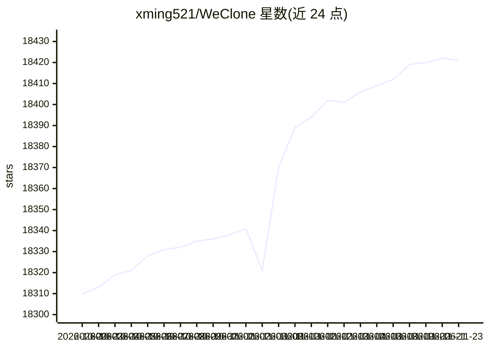

# xming521/WeClone

⭐ 18,421 · Python · AGPL-3.0 · 推送 2026-11-16 · [GitHub](https://github.com/xming521/WeClone) · [官网](https://weclone.love) · 个人维护 · 中文 README

**从聊天记录构建个人生活画像，供个人助手与数字分身使用**

从个人数字生活（当前支持 Telegram 导出的文本聊天）中提取、组织并总结生活画像，按工作、家庭、健康等领域组织，每条事实可溯源、可审阅、可编辑，存储默认本地加密。画像可通过 MCP 或导出文本供 Claude Code、Codex 等个人助手作为长期记忆使用；另保留原有微调工作流：在聊天记录上以 LoRA 微调开源模型，经 AstrBot 或 LangBot 部署到聊天平台，训练前用 Microsoft Presidio 过滤个人信息。画像提取目前仅支持中文，英文聊天未经测试。

## 筛选速览

| 维度 | 判定 | 备注 |
|---|---|---|
| AI 角色 | `ai-native` | 本体是模型或模型工具 |
| 许可风险 | `viral` | AGPL-3.0 |
| 部署形态 | `library` | 以包/库形式分发 |
| 模型依赖 | locked-api |  |
| 硬件要求 | — | 无带数字的原话,不猜 |
| 安装摩擦 | `low` | 无编译、无系统依赖或容器化 |
| 成熟度 | — | 结构信号不足 |

## 动量与使用信号

- 维护:`active` — 距上次 push 0.7 天,年发版 1,14 位贡献者
- 涨星:近 1 天 **+5**(自 20261016 起算)
- 安装:pypi 包 `main` 月下载 1
- 平台:WINDOWS · 协议:—

## 能力要点

- build-profile 一条命令提取并组织生活画像，Web UI 逐条审阅
- 画像通过 MCP 供个人助手读取，按领域与隐私级别控制访问
- LoRA 微调聊天记录生成数字分身，经 AstrBot/LangBot 接入聊天平台
- 179 项十类说话风格分析；默认本地加密存储

## 适用场景

- 把自己的聊天记录整理成可供 AI 助手查阅的个人画像
- 微调一个模仿自己说话风格的分身并部署到 Telegram 等平台
- 按隐私级别控制助手能读取哪些个人信息

## 场景标签

`Agent 记忆` `微调` `AI 助手` `聊天机器人` · 领域:Agent 开发

## 证据(README 行号)

> L22: WeClone distills your identity, goals, preferences and current situation from your digital life into a life portrai
> L33: - 🎭 **Your own AI clone**: fine-tune an open model on your chat history and deploy it to Telegram, Discord, Slack, 
> L34: - 🧠 **Connect personal assistants**: Claude Code, Codex, dots, Muse, Grok Bot and other personal assistants use you

## 星数曲线

2026-10-20 18,310 → 2026-11-23 18,421（+111）

---
*卡片 v1 · prompt 1.4 · 生成 2026-11-22 · 置信度 high · 依据 README sha `391f7fc68609` · [字段定义](../../DATASET.md)*
