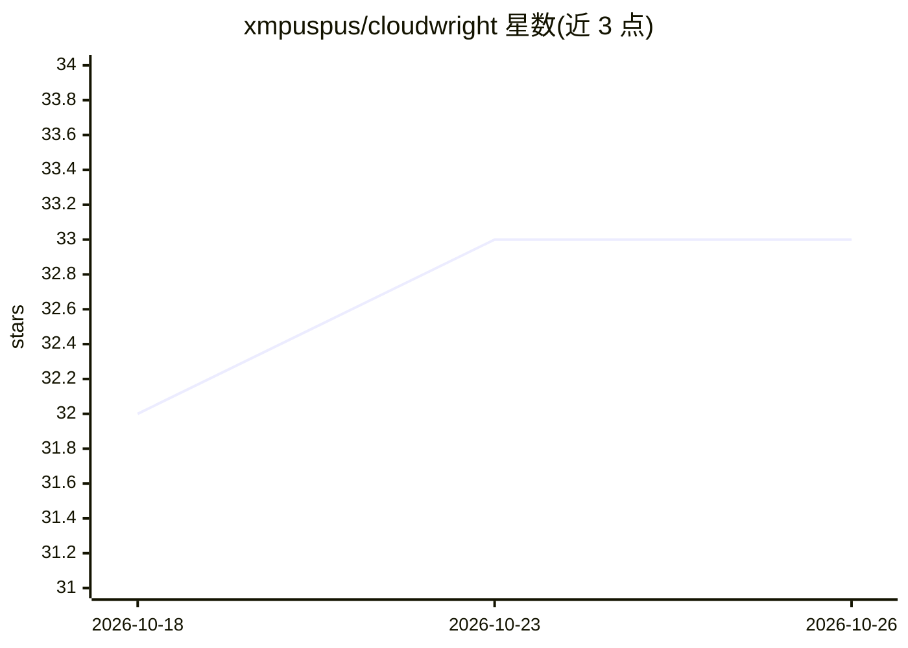

# xmpuspus/cloudwright

⭐ 33 · Python · MIT · 推送 2026-08-24 · [GitHub](https://github.com/xmpuspus/cloudwright) · 个人维护

**自然语言生成云架构的 CLI：Terraform、成本与合规报告**

面向云架构师与 DevOps 的 Python CLI/库：输入一句英文经模型生成类型化 YAML 规范，再离线产出区域感知成本估算、映射到 HIPAA/SOC 2/PCI-DSS 等控制 ID 的合规报告，以及 Terraform/OpenTofu/Pulumi/CloudFormation 基础设施代码。仅 design/modify/chat/adr 四个命令调用模型（Anthropic 或 OpenAI），其余命令离线运行无需 API key。另含迁移规划与证据门、MCP server（24 个工具、支持 11 个编码 agent 接入）、可编辑 Web 画布。覆盖 AWS/GCP/Azure/Databricks 共 114 个服务键，要求 Python 3.12+。

## 筛选速览

| 维度 | 判定 | 备注 |
|---|---|---|
| AI 角色 | `ai-enhanced` | 去掉 AI 部分产品仍成立 |
| 许可风险 | `permissive` | MIT |
| 部署形态 | `library` | 以包/库形式分发 |
| 模型依赖 | locked-api |  |
| 硬件要求 | — | 无带数字的原话,不猜 |
| 安装摩擦 | `low` | 无编译、无系统依赖或容器化 |
| 成熟度 | — | 结构信号不足 |

## 能力要点

- 一句英文生成规范、成本、合规报告与 Terraform 代码
- 每条发现映射 HIPAA/SOC 2/FedRAMP 等控制 ID，plan 以 terraform validate 给出 DEPLOYABLE 判定
- 仅 4 个命令调用模型，其余离线运行无需 API key
- MCP server 暴露 24 个工具，经 cloudwright integrate 接入 11 个编码 agent

## 适用场景

- 用自然语言起草合规要求的云架构并导出 Terraform
- 在部署前获取成本估算与控制 ID 映射的合规报告
- 为编码 agent 接入云设计/校验/迁移工具集
- 规划迁移波次并用证据门核验

## 场景标签

`代码生成` · 领域:编码与开发

## 证据(README 行号)

> L17: and evidence gates. It covers AWS, GCP, Azure and Databricks across 114 service keys. Only `design`, `modify`,
> L44: Add `--json` before any subcommand for machine-readable output, or `--stream` to watch tokens arrive. Set `ANTHROPI

## 星数曲线

2026-10-18 32 → 2026-10-26 33（+1）

---
*卡片 v1 · prompt 1.4 · 生成 2026-10-25 · 置信度 high · 依据 README sha `0102202a5fcf` · [字段定义](../../DATASET.md)*
