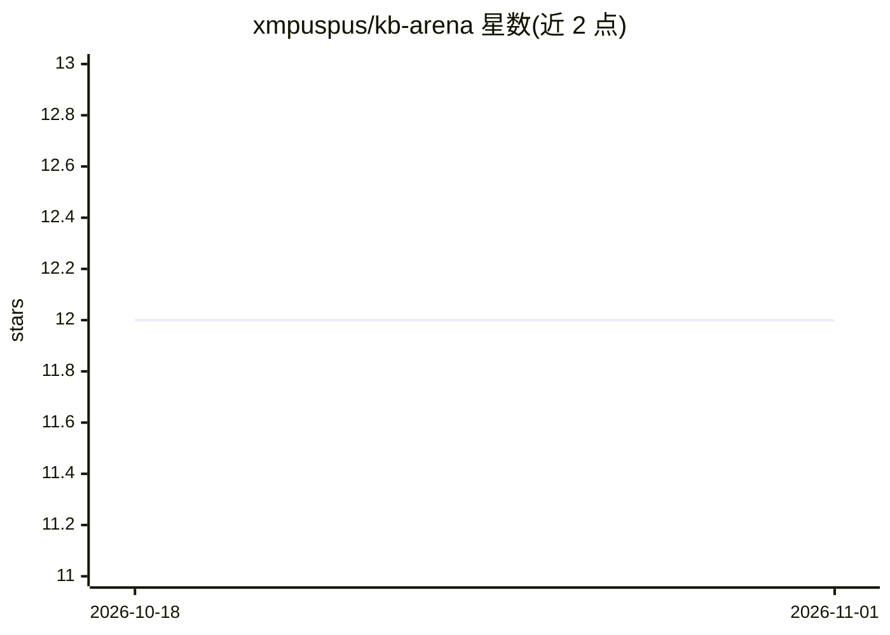

# xmpuspus/kb-arena

⭐ 12 · Python · MIT · 推送 2026-10-29 · [GitHub](https://github.com/xmpuspus/kb-arena) · [官网](https://pypi.org/project/kb-arena/) · 个人维护

**面向开发者：在自有文档上评测 19 种检索架构**

KB Arena 让同一语料与问题集通过 19 种内置检索策略（词法、稠密、图谱、混合、分层、重排等）运行，记录检索质量、回答质量、延迟、成本与运行产物，用于在选定检索架构前做依据充分的决策或作为回归实验室。提供 CLI、HTTP API、MCP server、GitHub Action 四种使用方式；BM25 路径无需 API key。支持本地 Ollama 与托管模型作为生成/嵌入后端，图谱类策略需 Neo4j。仓库附带 aws-compute 与 NIST SP 800-171 语料及历史评测数据。

## 筛选速览

| 维度 | 判定 | 备注 |
|---|---|---|
| AI 角色 | `ai-ecosystem` | LLM/agent 周边工具 |
| 许可风险 | `permissive` | MIT |
| 部署形态 | `library` | 以包/库形式分发 |
| 模型依赖 | local-ok | 支持本地模型 |
| 硬件要求 | — | 无带数字的原话,不猜 |
| 安装摩擦 | `low` | 无编译、无系统依赖或容器化 |
| 成熟度 | — | 结构信号不足 |

## 能力要点

- 19 种内置检索策略（BM25、向量、图谱、RAPTOR、HyDE、SPLADE 等）
- 报告 Recall@k/MRR/NDCG 等指标并附置信区间与 Wilcoxon 检验
- pip 安装后 kb-arena demo 无需 API key 即可查看预计算结果
- 提供 CLI / HTTP API / MCP server / GitHub Action 四种运行方式

## 适用场景

- 在搭建知识库前比较多种检索架构选型
- 语料、分块或模型变更后做检索质量回归测试
- 在自有文档上跑 BM25 基线做零成本评测

## 场景标签

`模型评测` `RAG` · 领域:评测与运维

## 证据(README 行号)

> L11: KB Arena runs the same corpus and question set through 19 built-in retrieval strategies,
> L16: Use it before you commit to a retrieval architecture, or as a regression lab after your corpus,
> L210: kb-arena benchmark --corpus my-docs --top-k 5

## 星数曲线

2026-10-18 12 → 2026-11-01 12（+0）

---
*卡片 v1 · prompt 1.4 · 生成 2026-10-31 · 置信度 high · 依据 README sha `fcadb5c42130` · [字段定义](../../DATASET.md)*
