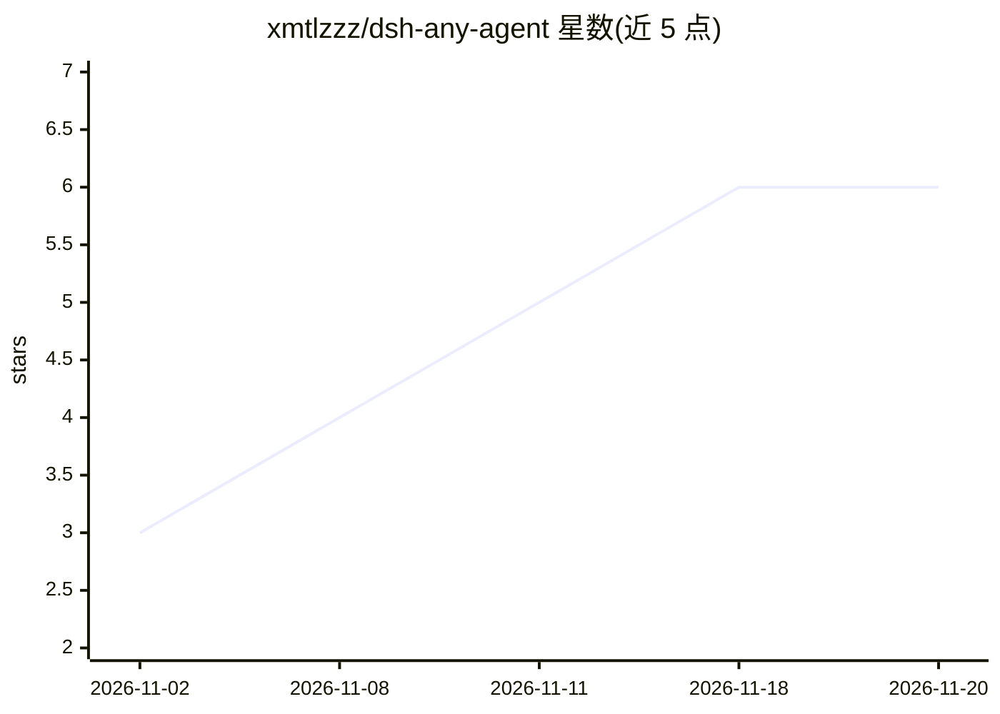

# xmtlzzz/dsh-any-agent

⭐ 6 · JavaScript · MIT · 推送 2026-11-19 · [GitHub](https://github.com/xmtlzzz/dsh-any-agent) · [官网](https://dsh-any-agent.xmtlz.dev/) · 个人维护

**MCP 服务器：让任意 MCP 客户端驱动 DSH 作为长驻编码 agent**

一个 MCP 服务器，把 DeepSeek Harness（DSH）封装为可被任何 stdio MCP 客户端调用的长驻编码 agent。核心机制包括：会话身份落盘实现跨进程崩溃恢复、dsh_send 异步派发并以哨兵文件通知完成、中途插话/排队打断、调用方 review 工单核验结果、可选 Git worktree 隔离、终端/网页调用链实时视图。定位为调度器，不代理 DSH 自身的文件/工具能力。依赖 Node.js ≥ 22.15 和已配置模型路由与凭据的 DSH。

## 筛选速览

| 维度 | 判定 | 备注 |
|---|---|---|
| AI 角色 | `ai-ecosystem` | LLM/agent 周边工具 |
| 许可风险 | `permissive` | MIT |
| 部署形态 | `library` | 以包/库形式分发 |
| 模型依赖 | — | README 未给出锁定关系 |
| 硬件要求 | — | 无带数字的原话,不猜 |
| 安装摩擦 | `low` | 无编译、无系统依赖或容器化 |
| 成熟度 | — | 结构信号不足 |

## 能力要点

- 会话身份落盘，崩溃或重启后自动恢复对话与记忆
- 异步派发 + 原子哨兵文件完成通知，无需轮询
- dsh_interject 支持运行中插话与排队而不破坏对话
- watch/dashboard 提供调用链实时视图与 token 用量

## 适用场景

- 把耗时数小时的编码任务交给后台 agent 后离开，回来收取结果
- 在编辑器重启或会话中断后继续未完成的编码对话
- 同时运行多个编码 agent 会话并切换查看
- 对运行中的 agent 中途纠偏或审批其工具调用请求

## 场景标签

`编码 Agent` · 领域:编码与开发

## 证据(README 行号)

> L17: An MCP server that drives DeepSeek Harness as a **long-lived coding agent**. Hand it a goal, let it write code and 
> L19: **Claude Code · Claude Desktop · Codex · Cursor · Windsurf · Zed · Gemini CLI · Antigravity · opencode · VS Code** 
> L77: **Only dispatch semantics become tools**: start, send, read, get, review, interject,

## 星数曲线

2026-11-02 3 → 2026-11-20 6（+3）

---
*卡片 v1 · prompt 1.4 · 生成 2026-11-20 · 置信度 high · 依据 README sha `6792ccfff5d9` · [字段定义](../../DATASET.md)*
