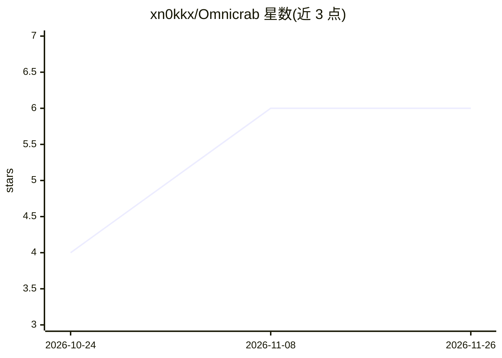

# xn0kkx/Omnicrab

⭐ 6 · Rust · MIT · 推送 2026-11-02 · [GitHub](https://github.com/xn0kkx/Omnicrab) · 个人维护

**终端 TUI：多 AI 账号与本地模型的聊天/编排管理**

基于 Rust 的终端 UI，接入多个 AI 提供商账号与本地模型，支持对话、对比与多 agent 协作编排。按账号跟踪请求数、token 与成本，设置月度预算，显示订阅限额使用进度；写入 PostgreSQL 的数据均先加密，首次启动设置不可恢复的主密码。安装需要 Linux、Rust 与 PostgreSQL，通过 cargo 从源码编译。

## 筛选速览

| 维度 | 判定 | 备注 |
|---|---|---|
| AI 角色 | `ai-ecosystem` | LLM/agent 周边工具 |
| 许可风险 | `permissive` | MIT |
| 部署形态 | `library` | 以包/库形式分发 |
| 模型依赖 | local-ok | 支持本地模型 |
| 硬件要求 | — | 无带数字的原话,不猜 |
| 安装摩擦 | `low` | 无编译、无系统依赖或容器化 |
| 成熟度 | — | 结构信号不足 |

## 能力要点

- 多账号接入 Anthropic/OpenAI/Gemini 等 8 家提供商与 Ollama 本地模型
- /fanout 一发多收与 /orchestrate 多 agent 任务拆分编排
- 按账号的用量/成本统计、月度预算与自动故障转移
- 数据加密后存入 PostgreSQL，主密码不存储

## 适用场景

- 在同一终端管理多个 AI 订阅账号并对比回答
- 用多个账号共同拆分执行一个任务
- 跟踪各账号 token 用量与订阅限额消耗

## 场景标签

`多智能体` `聊天机器人` · 领域:Agent 开发

## 证据(README 行号)

> L3: omnicrab is a terminal UI that connects many AI accounts and local models and lets you chat with them, compare them,
> L20: You need Linux, Rust, and PostgreSQL.
> L25: cargo install --path . --root ~/.local --locked   # installs `omnicrab` into ~/.local/bin

## 星数曲线

2026-10-24 4 → 2026-11-26 6（+2）

---
*卡片 v1 · prompt 1.4 · 生成 2026-11-20 · 置信度 high · 依据 README sha `f36c33001f32` · [字段定义](../../DATASET.md)*
