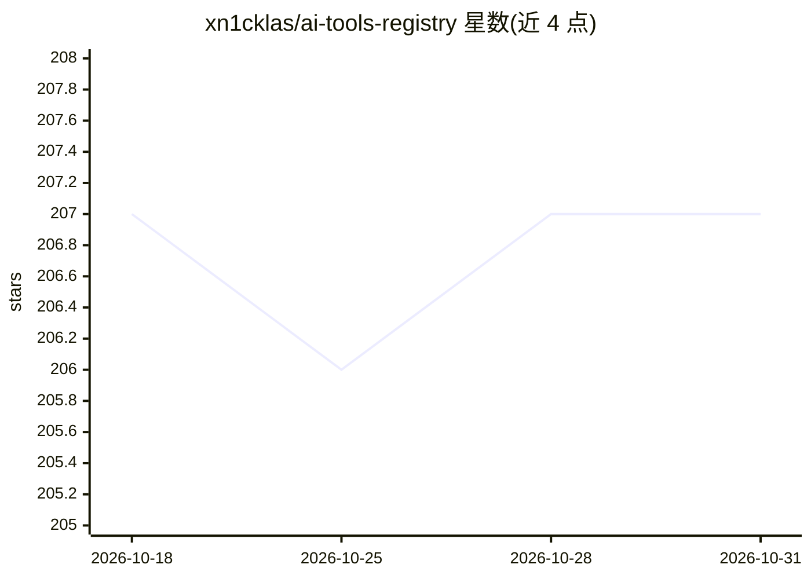

# xn1cklas/ai-tools-registry

⭐ 207 · TypeScript · 推送 2025-12-06 · [GitHub](https://github.com/xn1cklas/ai-tools-registry) · [官网](https://ai-tools-registry.vercel.app) · 个人维护

**基于 shadcn CLI 分发 Vercel AI SDK 工具的注册表**

用 shadcn/ui 构建的示例注册表，提供可安装的 AI Tools registry：工具以纯文件形式发布，通过在 components.json 配置远程 registry 后用 npx shadcn add 命令添加到项目中，部分工具附带 React 组件渲染结果（如 WeatherCard）。示例工具包括 weather、news、stats 与 web-search（默认走 DuckDuckGo Instant Answer，设置 BRAVE_SEARCH_API_KEY 后自动切换 Brave Search）。工具依赖 AI SDK v5 与 zod，需由应用自行提供。面向使用 Vercel AI SDK 与 shadcn 的 Node.js 开发者。

## 筛选速览

| 维度 | 判定 | 备注 |
|---|---|---|
| AI 角色 | `ai-ecosystem` | LLM/agent 周边工具 |
| 许可风险 | `none` | — |
| 部署形态 | `library` | 以包/库形式分发 |
| 模型依赖 | — | README 未给出锁定关系 |
| 硬件要求 | — | 无带数字的原话,不猜 |
| 安装摩擦 | `low` | 无编译、无系统依赖或容器化 |
| 成熟度 | — | 结构信号不足 |

## 能力要点

- 通过 shadcn CLI 远程 registry 按需安装 AI SDK 工具
- 工具可附带 React 结果渲染组件（WeatherCard/NewsList 等）
- web-search 默认用 DuckDuckGo 无需 key，可切 Brave Search API

## 适用场景

- 给 AI SDK 项目快速添加现成的 tool calling 工具
- 为工具结果配套 UI 渲染组件
- 作为 shadcn 远程 registry 的搭建参考

## 场景标签

`Agent 框架` · 领域:Agent 开发

## 证据(README 行号)

> L5: It now also includes an installable AI Tools registry (for Node.js) based on the Vercel AI SDK Tool Calling APIs. To
> L52: Note: The example tools import from `ai` (AI SDK v5) and `zod`. Ensure your app provides these dependencies.

## 星数曲线

2026-10-18 207 → 2026-10-31 207（+0）

---
*卡片 v1 · prompt 1.4 · 生成 2026-10-22 · 置信度 high · 依据 README sha `729823f64f67` · [字段定义](../../DATASET.md)*
