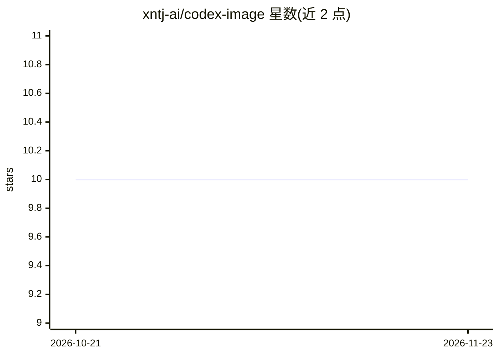

# xntj-ai/codex-image

⭐ 10 · Python · MIT · 推送 2026-06-30 · [GitHub](https://github.com/xntj-ai/codex-image) · [官网](https://xntj.tv/ep/live-ep0053) · 个人维护 · 中文 README

**让 Claude Code 用 ChatGPT/Codex 订阅额度调内置工具出图**

一个 Claude Code skill：把用户需求写成结构化提示词，通过脚本驱动 `codex exec` 调用 Codex 内置的 `image_gen` 工具生成图片，计费走 ChatGPT/Codex 订阅额度而非按张计费的 API。机制上以固定契约头强制调用真工具、按 spec 组织提示词、按 session-id 定位产出并做 PNG 头校验（并发安全）。限制：分辨率固定约 1.57MP 非 4K，Plus 订阅纯出图约 50 张/5 小时，长文字与精确排版不可靠。安装方式为把仓库放入 Claude Code skills 目录。

## 筛选速览

| 维度 | 判定 | 备注 |
|---|---|---|
| AI 角色 | `ai-native` | 本体是模型或模型工具 |
| 许可风险 | `permissive` | MIT |
| 部署形态 | `None` |  |
| 模型依赖 | — | README 未给出锁定关系 |
| 硬件要求 | — | 无带数字的原话,不猜 |
| 安装摩擦 | `low` | 无编译、无系统依赖或容器化 |
| 成熟度 | — | 结构信号不足 |

## 能力要点

- 驱动 `codex exec` 内置 `image_gen` 工具出图，计费走订阅额度，不使用 OPENAI_API_KEY
- 固定契约头禁止用代码/SVG/canvas 伪造图片，强制调用真工具
- 按 codex session-id 定位产出并解析 PNG 头校验尺寸，并发安全
- 支持 --transparent 色键抠图输出透明 PNG（需 Pillow）

## 适用场景

- 做 PPT、demo、网页配图时批量生成图片，走已付费的订阅额度
- 让 Claude Code 在对话中自动触发出图并校验产出
- 生成边缘清晰的实心主体的透明底 PNG

## 场景标签

`图像生成` · 领域:内容生成

## 证据(README 行号)

> L7: 做 PPT、出 demo、配网页图，一张张走 API 是按张烧钱的（几十页 PPT 轻松几百块）。但如果你已经在付 ChatGPT / Codex 的订阅，那份额度里就包含内置的图像生成工具。这个 skill 让 Claude Co
> L15:   └─ Claude Code 写成结构化提示词 (references/prompt-recipes.md)
> L57: - `codex --version` 能跑（已装 Codex CLI）。Codex CLI installed.

## 星数曲线

2026-10-21 10 → 2026-11-23 10（+0）

---
*卡片 v1 · prompt 1.4 · 生成 2026-11-19 · 置信度 high · 依据 README sha `fc854d1d5c93` · [字段定义](../../DATASET.md)*
