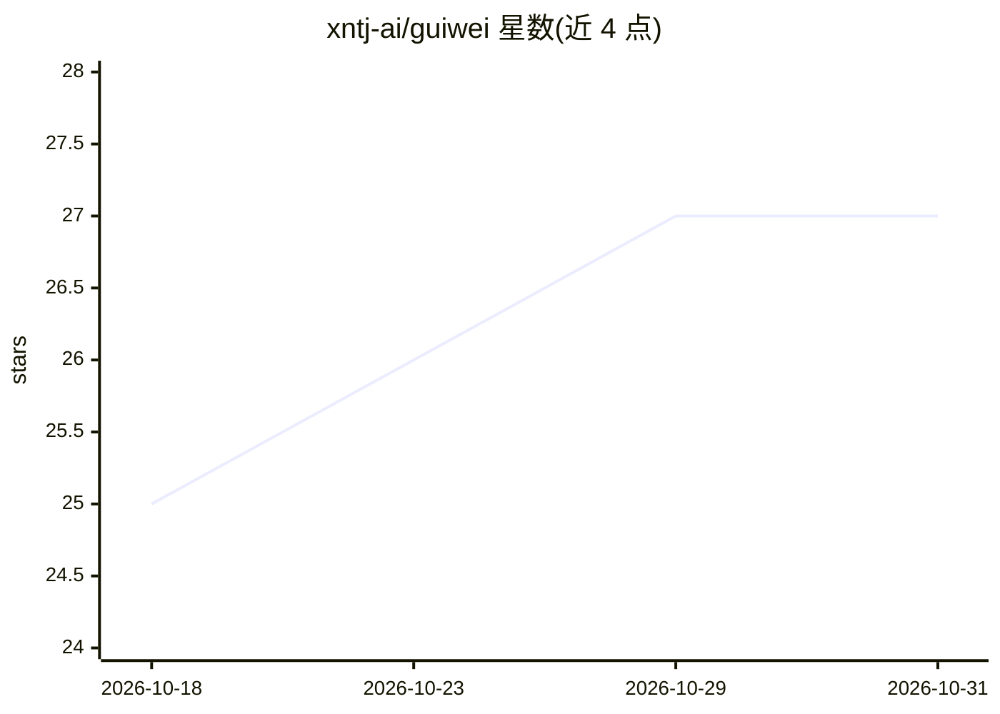

# xntj-ai/guiwei

⭐ 27 · Python · MIT · 推送 2026-08-14 · [GitHub](https://github.com/xntj-ai/guiwei) · 个人维护 · 中文 README

**本地 AI 文件自动整理服务：读懂文件后改名、归类、建可撤销索引**

运行在本地的文件整理后台服务：监控收件文件夹，文件落地后由大模型读取内容，按 `日期_类型_主体_主题` 改名并归入按模态与文档体裁划分的顶级文件夹，同时维护全文/标签可检索、每步可撤销的 SQLite 索引并生成 `目录.md`。文档与图片走 OpenAI 兼容接口，音视频走 Gemini。提供 dry-run 默认、undo 撤回、敏感词闸门（不读不外发）、sha256 去重等安全机制。实时监控（watch.ps1）仅支持 Windows/PowerShell，organize.py 引擎跨平台；音视频功能需 ffmpeg。

## 筛选速览

| 维度 | 判定 | 备注 |
|---|---|---|
| AI 角色 | `ai-native` | 本体是模型或模型工具 |
| 许可风险 | `permissive` | MIT |
| 部署形态 | `library` | 以包/库形式分发 |
| 模型依赖 | — | README 未给出锁定关系 |
| 硬件要求 | — | 无带数字的原话,不猜 |
| 安装摩擦 | `medium` | 含编译或系统依赖之一 |
| 成熟度 | — | 结构信号不足 |

## 能力要点

- 大模型按 `日期_类型_主体_主题` 规则改名并归类文件
- 可全文/标签检索的索引 + 目录.md，每步移动可 undo 撤回
- 敏感词闸门：命中隐私词的文件不读内容、不发大模型，索引打码
- scan 默认 dry-run，另有 search/reindex/reconcile/migrate 等命令

## 适用场景

- 把下载文件夹丢进收件夹，自动改名归档
- AI 产出的大量网页、录音、视频文件的批量整理
- 建立可检索、可撤销的个人文件索引供自己和 Agent 调用

## 场景标签

`工作流自动化` `语义搜索` · 领域:效率与自动化

## 证据(README 行号)

> L6: 归位是一个**本地**的文件自动整理服务。它盯着一个「收件」文件夹，你往里丢任何文件（下载的、别人发的、AI 产出的），它就用大模型读取内容，按 `日期_类型_主体_主题` 改名，归类到对应文件夹，并维护一套可全文/标签检索、且**
> L8: *guiwei is a **local** file-organizing service. It watches an inbox folder; whenever a file lands (a download, somet
> L34: **依赖 · Requirements**: Python 3.11+，`pip install pymupdf pillow openpyxl`（docx/pptx/html 走标准库，零额外依赖）。音视频功能需要 `ffmpe

## 星数曲线

2026-10-18 25 → 2026-10-31 27（+2）

---
*卡片 v1 · prompt 1.4 · 生成 2026-10-26 · 置信度 mid · 依据 README sha `83c880391ce1` · [字段定义](../../DATASET.md)*
