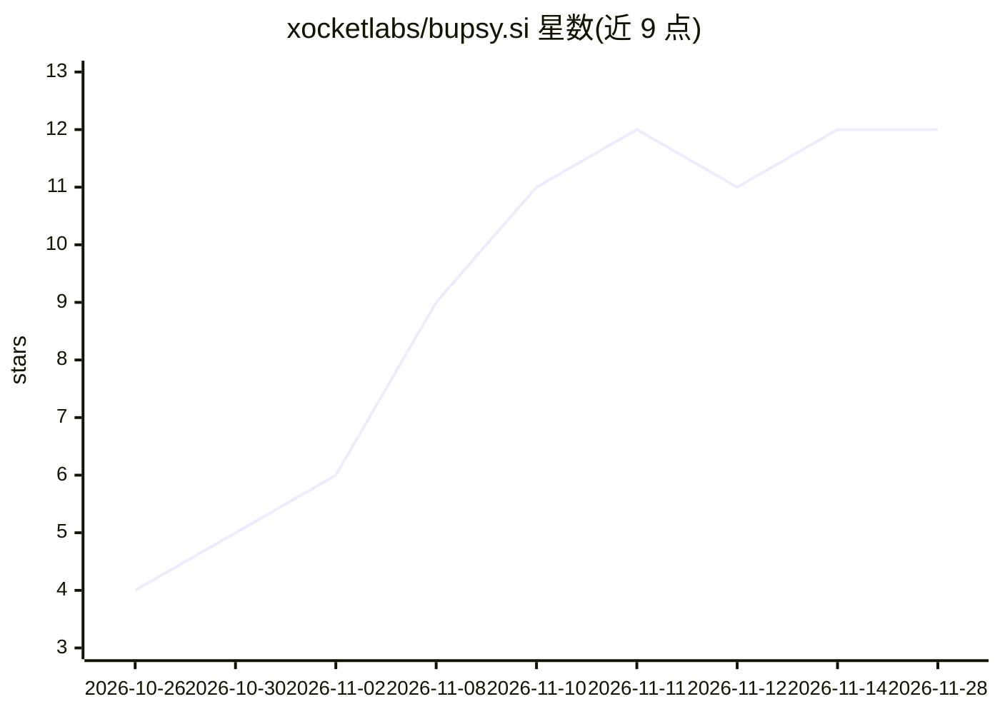

# xocketlabs/bupsy.si

⭐ 12 · Swift · NOASSERTION · 推送 2026-11-23 · [GitHub](https://github.com/xocketlabs/bupsy.si) · [官网](https://bupsy.si) · 组织维护

**macOS 原生应用：在自己的 Claude Code/Codex 订阅上运行 AI bot 团队**

一个 macOS 原生（SwiftUI）桌面应用，用于托管多个 AI bot：每个 bot 是运行用户自有 Claude Code 或 Codex 登录的 agent，也可搭配 Ollama/LM Studio 本地模型；支持 bot 之间交接任务、定时例程、常驻目标、MCP 服务器接入与四级信任审批。无自有后端、无遥测，凭据由用户与 CLI 持有而非应用。分发未公证的 DMG 或从源码构建，需 macOS 14+ 与已安装并登录的 CLI；iOS、Windows、Linux 版本尚在开发中。

## 筛选速览

| 维度 | 判定 | 备注 |
|---|---|---|
| AI 角色 | `ai-native` | 本体是模型或模型工具 |
| 许可风险 | `none` | NOASSERTION |
| 部署形态 | `desktop` | 安装包/桌面程序 |
| 模型依赖 | local-ok | 支持本地模型 |
| 硬件要求 | — | 无带数字的原话,不猜 |
| 安装摩擦 | `low` | 无编译、无系统依赖或容器化 |
| 成熟度 | `idea` | |

## 能力要点

- 每个 bot 以用户自有登录运行 claude 或 codex CLI，或切换 Ollama/LM Studio 本地模型
- bot 互相发消息、交接工作、创建新 bot，并有四级信任审批机制
- 例程与常驻目标可在本机持续运行（应用关闭时也可触发）
- 通过 Tailscale 从手机或其他 Mac 访问，并可在 Mac 之间移动 bot

## 适用场景

- 用已有订阅在 Mac 上托管多个常驻 AI bot 执行日常任务
- 给 bot 接入 GitHub/Slack/Notion 等 MCP 服务器并要求先审批再行动
- 在无云后端的条件下本地管理 agent 对话记录与审计日志

## 场景标签

`编码 Agent` `多智能体` · 领域:Agent 开发

## 证据(README 行号)

> L15: Each bot is a real agent: `claude` or `codex` running under **your own sign-in**, on your Mac or
> L55: |**Chat**|Claude Code, Codex, or a local model in Ollama or LM Studio, switchable per bot, each keeping its own thr

## 星数曲线

2026-10-26 4 → 2026-11-28 12（+8）

---
*卡片 v1 · prompt 1.4 · 生成 2026-11-18 · 置信度 high · 依据 README sha `e0ef33c0a6be` · [字段定义](../../DATASET.md)*
