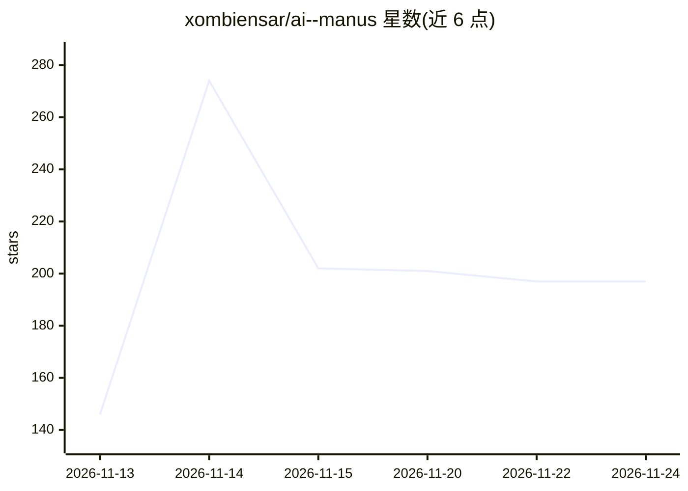

# xombiensar/ai--manus

⭐ 197 · Apache-2.0 · 推送 2026-11-15 · [GitHub](https://github.com/xombiensar/ai--manus) · 个人维护

**自主 AI Agent：代替用户执行代码与控制浏览器完成任务**

面向家庭、学习与轻量办公场景的自主 AI 代理：用户以自然语言下达指令，代理自行规划步骤、编写并执行脚本、控制浏览器打开网页与填写表单，完成多步骤任务。定位为后台个人助手，不要求用户具备开发背景；支持跨会话复用已习得的工作流模式。README 提供硬件兼容表（最低双核 CPU、4 GB 内存）与配置/测试步骤说明，但未给出可验证的安装命令、模型接入方式或代码仓库结构，实际实现细节不可核验。

## 筛选速览

| 维度 | 判定 | 备注 |
|---|---|---|
| AI 角色 | `ai-native` | 本体是模型或模型工具 |
| 许可风险 | `permissive` | Apache-2.0 |
| 部署形态 | `None` |  |
| 模型依赖 | — | README 未给出锁定关系 |
| 硬件要求 | — | 无带数字的原话,不猜 |
| 安装摩擦 | `low` | 无编译、无系统依赖或容器化 |
| 成熟度 | — | 结构信号不足 |

## 能力要点

- 自主编写并执行代码完成多步骤任务
- 浏览器控制：导航网页、填表、采集信息
- 代码与浏览器操作可在同一任务流中衔接
- 后台运行的个人助手定位，面向非开发者用户

## 适用场景

- 让代理替我查网页、填表、收集资料
- 整理研究笔记、跑小脚本等学习杂务
- 远程排查时快速执行诊断步骤

## 场景标签

`AI 助手` `浏览器自动化` `编码 Agent` · 领域:效率与自动化

## 证据(README 行号)

> L10: - **Autonomous Code Execution:** Manus AI agent runs code on its own to complete tasks, so you can focus on decisio
> L18: Manus is an autonomous AI agent designed to run code and control a browser on your behalf. Instead of acting like a
> L22: Manus is not a heavy studio suite or a complex enterprise platform. It is a focused helper built for home, study, a

## 星数曲线

2026-11-13 146 → 2026-11-24 197（+51）

---
*卡片 v1 · prompt 1.4 · 生成 2026-11-17 · 置信度 mid · 依据 README sha `fbfd5e977bf4` · [字段定义](../../DATASET.md)*
