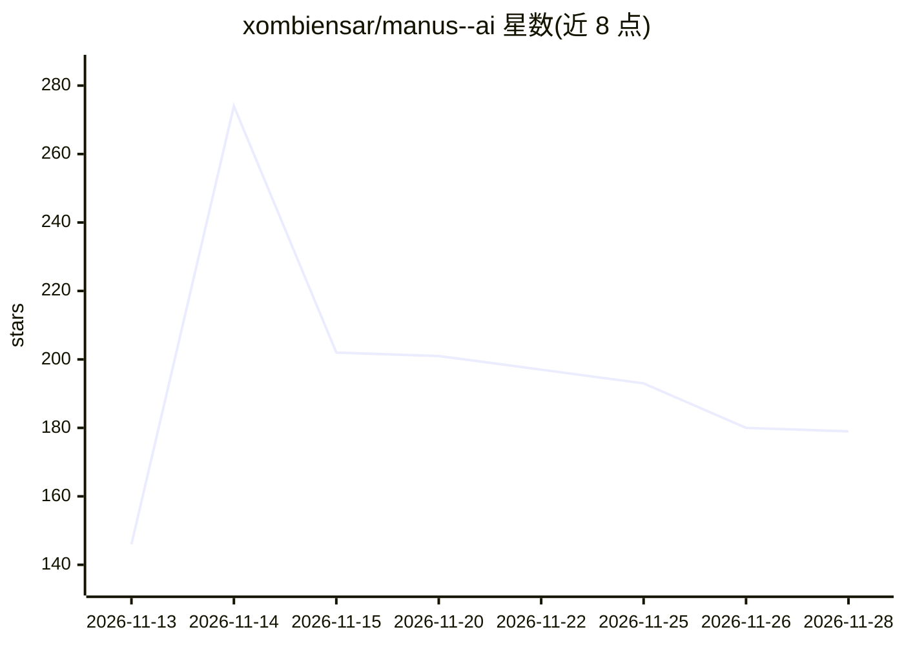

# xombiensar/manus--ai

⭐ 179 · Apache-2.0 · 推送 2026-11-15 · [GitHub](https://github.com/xombiensar/manus--ai) · 个人维护

**面向个人用户的自主 AI Agent：代为执行代码与浏览器操作**

README 描述 Manus 为自主 AI agent，可代替用户编写并执行脚本、控制浏览器完成导航/填表/信息收集等多步任务，定位为家庭、学习与轻量办公场景的个人助手，非企业平台。给出最低/推荐硬件配置（双核 CPU、4GB/8GB 内存）与上手步骤（配置、测试、定制自动任务类型）。README 未提供具体安装命令、技术架构、支持的模型或 API 接入方式，无法验证其实际实现；仓库主题标签含 openai/anthropic/gemini/function-calling/react，但正文未展开。

## 筛选速览

| 维度 | 判定 | 备注 |
|---|---|---|
| AI 角色 | `ai-native` | 本体是模型或模型工具 |
| 许可风险 | `permissive` | Apache-2.0 |
| 部署形态 | `None` |  |
| 模型依赖 | — | README 未给出锁定关系 |
| 硬件要求 | — | 无带数字的原话,不猜 |
| 安装摩擦 | `low` | 无编译、无系统依赖或容器化 |
| 成熟度 | — | 结构信号不足 |

## 能力要点

- 自主代码执行：agent 自行编写并运行脚本完成任务
- 浏览器控制：导航网页、填表、收集信息
- 面向小规模场景（学习/家庭/轻办公）的后台个人助手

## 适用场景

- 让 agent 代为完成重复的脚本与网页操作
- 学生整理研究笔记、跑快速计算
- 远程工作者从多页面收集数据做摘要

## 场景标签

`AI 助手` `浏览器自动化` · 领域:效率与自动化

## 证据(README 行号)

> L10: - **Autonomous Code Execution:** Manus AI agent runs code on its own to complete tasks, so you can focus on decisio
> L18: Manus is an autonomous AI agent designed to run code and control a browser on your behalf. Instead of acting like a

## 星数曲线

2026-11-13 146 → 2026-11-28 179（+33）

---
*卡片 v1 · prompt 1.4 · 生成 2026-11-17 · 置信度 low · 依据 README sha `fbfd5e977bf4` · [字段定义](../../DATASET.md)*
