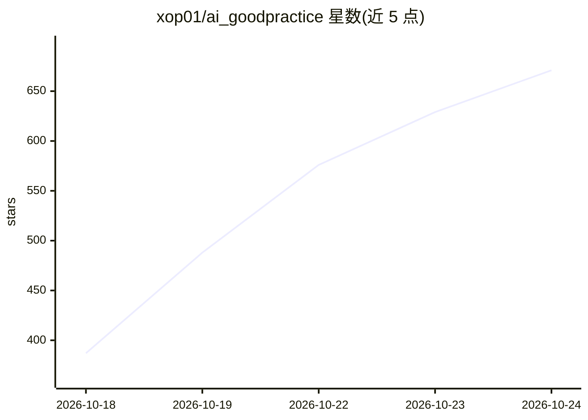

# xop01/ai_goodpractice

⭐ 671 · 推送 2026-10-02 · [GitHub](https://github.com/xop01/ai_goodpractice) · 个人维护

**手写 AI 编码工作流经验指南：教人用 agentic 方式开发**

个人长期使用经验总结的 agentic coding 指南文档，面向初学者与有经验的开发者，主张让 AI 代写代码、用户转任管理者角色。内容分三步：环境搭建（IDE 选型、rules/skills/MCP 配置与提示词写法）、避免低质 AI 输出（自建规则与技能而非套用网上的）、以及作者自制的 project progress MCP（Zig 编写，用于记录项目进度路线图防 AI 漂移）。README 声明全文手工撰写。

## 筛选速览

| 维度 | 判定 | 备注 |
|---|---|---|
| AI 角色 | `ai-knowledge` | 知识聚合/清单类 |
| 许可风险 | `none` | — |
| 部署形态 | `None` |  |
| 模型依赖 | — | README 未给出锁定关系 |
| 硬件要求 | — | 无带数字的原话,不猜 |
| 安装摩擦 | `low` | 无编译、无系统依赖或容器化 |
| 成熟度 | — | 结构信号不足 |

## 能力要点

- 以 rules/skills/MCP 为核心的 agentic 工作流配置方法与提示词示例
- 主张自建规则与技能以适配自身工作流
- 介绍自制 project progress MCP：记录项目进度与路线图，防止 AI 开发漂移
- 作者声明指南全文手工撰写、无 AI 参与

## 适用场景

- 从传统编码转向 agentic 编码工作流
- 学习如何编写 rules、skills 与选用 MCP
- 了解用文档和进度记录约束 AI 开发行为

## 场景标签

`提示工程` `教程课程` · 领域:Agent 开发

## 证据(README 行号)

> L8: To keep it short i have been using AI 8h+ per working day (without exaggerating) for a lot of months now, before i s
> L46: ## Step 1 (Setup)
> L109: On that note, i will share an MCP that i made (coded in Zig to be compilable on every OS, coded strictly with a fu

## 星数曲线

2026-10-18 387 → 2026-10-24 671（+284）

---
*卡片 v1 · prompt 1.4 · 生成 2026-10-21 · 置信度 high · 依据 README sha `4f46d9efb229` · [字段定义](../../DATASET.md)*
