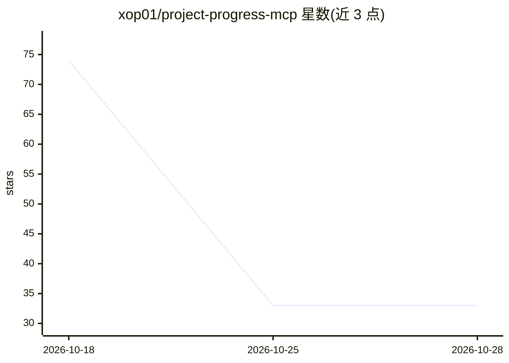

# xop01/project-progress-mcp

⭐ 34 · Zig · 推送 2026-10-04 · [GitHub](https://github.com/xop01/project-progress-mcp) · 个人维护

**Zig 编写的 MCP 服务器：让编码 agent 持久化项目进度并检测漂移**

面向编码 agent 的 MCP 服务器，以 JSON-RPC 2.0 over stdio 通信。提供 6 个工具：bootstrap 初始化项目与用户批准的目标、session_check 对比 git 状态与文件 SHA-256/大小/mtime 检测漂移、index 事务性存储进度索引并渲染 project_progress.md（基于 revision 的冲突检测）、register_docs 注册并写入文档（拒绝越界路径）、record_snapshot 记录基线快照、context 返回工作队列与续接元数据。服务器本身不含 LLM，分析与总结由 agent 完成，MCP 只做校验与存储。需 Zig 与 SQLite 开发包从源码构建，Windows 上经 Zig 0.16.0 验证。

## 筛选速览

| 维度 | 判定 | 备注 |
|---|---|---|
| AI 角色 | `ai-ecosystem` | LLM/agent 周边工具 |
| 许可风险 | `none` | — |
| 部署形态 | `desktop` | 安装包/桌面程序 |
| 模型依赖 | — | README 未给出锁定关系 |
| 硬件要求 | — | 无带数字的原话,不猜 |
| 安装摩擦 | `low` | 无编译、无系统依赖或容器化 |
| 成熟度 | — | 结构信号不足 |

## 能力要点

- session_check 以 git 状态与文件 SHA-256 哈希检测漂移，返回结构化 action_required
- index 更新基于单调递增 revision 的冲突检测，事务失败可回滚 Markdown
- register_docs 校验安全相对路径，拒绝符号链接越界与 Windows 设备名
- SQLite 使用 WAL 模式与忙等待，支持并发 agent 会话

## 适用场景

- 编码 agent 跨会话保持项目目标与进度记录不漂移
- 会话开始前检测自上次保存以来项目文件的变更
- 为 agent 维护持久化的项目进度 Markdown 与文档索引

## 场景标签

`Agent 记忆` · 领域:Agent 开发

## 证据(README 行号)

> L3: A Zig MCP server that lets coding agents persist project goals, progress notes,
> L6: The server is intentionally mechanical. Agents do the analysis, scanning,
> L66: The server speaks JSON-RPC 2.0 over stdio. Clients may send one JSON object per

## 星数曲线

2026-10-18 74 → 2026-10-28 33（-41）

---
*卡片 v1 · prompt 1.4 · 生成 2026-10-24 · 置信度 high · 依据 README sha `fb78d9fa83d7` · [字段定义](../../DATASET.md)*
