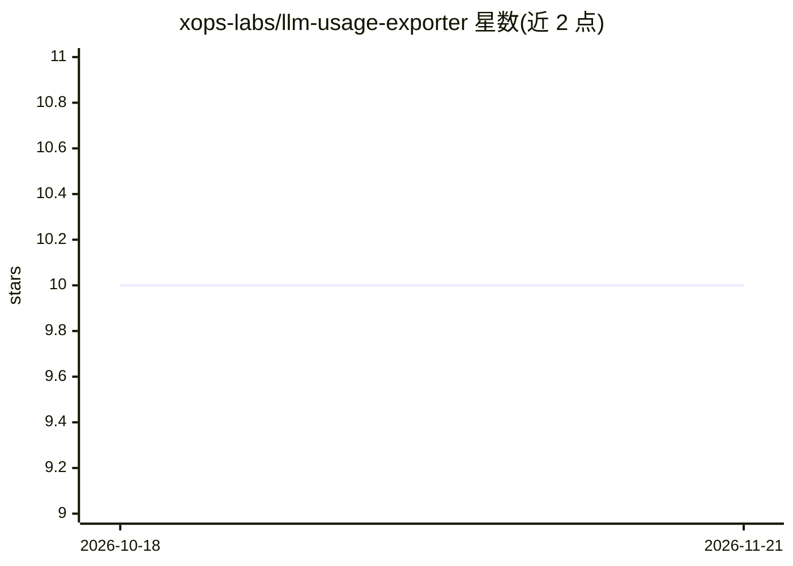

# xops-labs/llm-usage-exporter

⭐ 10 · C# · NOASSERTION · 推送 2026-11-01 · [GitHub](https://github.com/xops-labs/llm-usage-exporter) · [官网](https://github.com/xops-labs/llm-usage-exporter#readme) · 组织维护

**自托管 Prometheus 导出器，采集五大 LLM 用量与美元成本遥测**

面向平台、SRE、FinOps 与工程团队的 LLM 成本可观测组件：轮询 OpenAI、Azure OpenAI、Anthropic Claude、Google Gemini、AWS Bedrock 五家 provider 的用量与计费 API，将分桶记录归一化去重后以 Prometheus 计数器与 OpenTelemetry OTLP 指标重新发布，统一 llm_* 命名空间与 {tenant, provider, model, tenancy_id} 标签形状，默认低基数。附带预算燃烧比与 z-score 异常信号、FOCUS v1.0 记录输出与六个 Grafana 面板。README 明确声明导出值为运营信号而非发票级账单真相。以 .NET 10 单二进制运行，提供 Docker Compose 演示栈与生产 Helm chart。

## 筛选速览

| 维度 | 判定 | 备注 |
|---|---|---|
| AI 角色 | `ai-ecosystem` | LLM/agent 周边工具 |
| 许可风险 | `permissive` | NOASSERTION |
| 部署形态 | `self-host` | docker 或自建部署 |
| 模型依赖 | locked-api |  |
| 硬件要求 | — | 无带数字的原话,不猜 |
| 安装摩擦 | `low` | 无编译、无系统依赖或容器化 |
| 成熟度 | — | 结构信号不足 |

## 能力要点

- 轮询五家 provider 用量/计费 API，统一 llm_* 指标命名空间与 canonical 标签形状
- 同时输出 Prometheus、OTLP（gRPC+HTTP）与 FOCUS v1.0 三个输出面
- 预算燃烧比与按 (tenant, provider, model) 的成本/token z-score 异常信号
- Docker Compose 演示栈预置 7 天合成数据与六个自动导入的 Grafana 面板

## 适用场景

- 按项目与模型做近实时支出分摊、预算告警与下游对账
- 对轮询失败、数据滞后、异常 token 突发与失控成本设置告警
- 为成本优化定位 prompt caching 收益与失控 prompt
- 让 AI 编码 Agent 通过 Prometheus API 查询成本做预算感知建议

## 场景标签

`LLM 可观测性` · 领域:评测与运维

## 证据(README 行号)

> L29: **`llm-usage-exporter` is an open-source Prometheus exporter for LLM cost, token, and request telemetry.** It polls
> L112:     Exporter["llm-usage-exporter (.NET 10, single binary)"]
> L116: Five providers, three coordinated output planes (Prometheus + OTLP + FOCUS), one canonical `{tenant, provider, mod

## 星数曲线

2026-10-18 10 → 2026-11-21 10（+0）

---
*卡片 v1 · prompt 1.4 · 生成 2026-11-19 · 置信度 high · 依据 README sha `a4ad33d20375` · [字段定义](../../DATASET.md)*
