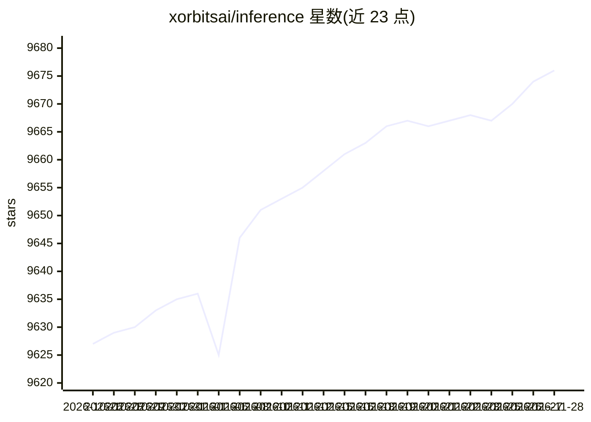

# xorbitsai/inference

⭐ 9,676 · Python · Apache-2.0 · 推送 2026-11-27 · [GitHub](https://github.com/xorbitsai/inference) · [官网](https://inference.readthedocs.io) · 组织维护 · 中文 README

**分布式模型推理平台：单机到集群部署并服务多种模态模型**

Xinference 是一个开源分布式推理平台：内置 300+ 语言、视觉、嵌入、重排、图像、音频、视频等模型，支持注册自定义模型（含 Flexible 类型的传统 ML 模型）。可选 vLLM、SGLang、TRT-LLM、Transformers、llama.cpp、MLX 等引擎，覆盖 CPU、GPU、Apple Silicon 与部分 MLU；支持添加 worker/副本的分布式服务与跨引擎 prefill/decode 分离。通过 Web UI 管理部署，经 OpenAI/Anthropic 兼容端点、Python SDK 或 CLI 调用。

## 筛选速览

| 维度 | 判定 | 备注 |
|---|---|---|
| AI 角色 | `ai-ecosystem` | LLM/agent 周边工具 |
| 许可风险 | `permissive` | Apache-2.0 |
| 部署形态 | `self-host` | docker 或自建部署 |
| 模型依赖 | local-ok | 支持本地模型 |
| 硬件要求 | — | 无带数字的原话,不猜 |
| 安装摩擦 | `low` | 无编译、无系统依赖或容器化 |
| 成熟度 | — | 结构信号不足 |

## 能力要点

- 300+ 内置模型目录，含语言/视觉/嵌入/重排/图像/音频/视频模态
- 多引擎选择：vLLM、SGLang、TRT-LLM、Transformers、llama.cpp、MLX
- 分布式部署：单机到集群，支持大模型跨 worker 与 P/D 分离
- Web UI、CLI、Python SDK 三种管理方式，OpenAI 兼容 API

## 适用场景

- 在自己的服务器或集群上部署并服务大模型
- 给应用提供 OpenAI 兼容的模型 API 端点
- 在 Web UI 里对聊天模型做吞吐与延迟基准测试
- 在异构硬件（CPU/GPU/Apple Silicon/MLU）上运行推理

## 场景标签

`推理引擎` · 领域:训练与推理

## 证据(README 行号)

> L3: **Xinference (Xorbits Inference) is an open-source distributed inference platform.**
> L5: Deploy and run models on heterogeneous hardware, from a local machine to a distributed cluster. Xinference includes 
> L63: |Engines and hardware|Choose vLLM, SGLang, TRT-LLM, Transformers, llama.cpp, or MLX for supported LLMs. Hardware su
> L65: |APIs and tools|OpenAI- and Anthropic-compatible endpoints, with streaming and tool calling where supported. Deploy

## 星数曲线

2026-10-26 9,627 → 2026-11-28 9,676（+49）

---
*卡片 v1 · prompt 1.4 · 生成 2026-11-28 · 置信度 high · 依据 README sha `db556054a182` · [字段定义](../../DATASET.md)*
