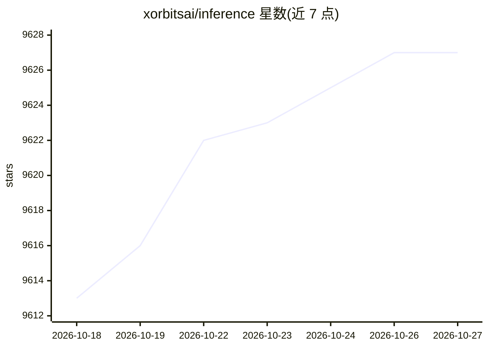

# xorbitsai/inference

⭐ 9,627 · Python · Apache-2.0 · 推送 2026-10-26 · [GitHub](https://github.com/xorbitsai/inference) · [官网](https://inference.readthedocs.io) · 组织维护 · 中文 README

**统一推理平台：一行命令部署语言/语音/多模态模型**

Xinference（Xorbits Inference）是面向研究人员、开发者与数据科学家的模型服务库，支持以单条命令部署和提供语言、语音识别与多模态模型的推理服务。支持多推理引擎（vLLM、llama.cpp 系 Xllamacpp、GGML、TensorRT）、分布式部署与异构 GPU/CPU 利用，对外提供 OpenAI 兼容 RESTful API（含 Function Calling）、RPC、CLI 与 WebUI。另设商业版 Xinference Enterprise 与 Xinference Cloud 托管部署。

## 筛选速览

| 维度 | 判定 | 备注 |
|---|---|---|
| AI 角色 | `ai-ecosystem` | LLM/agent 周边工具 |
| 许可风险 | `permissive` | Apache-2.0 |
| 部署形态 | `self-host` | docker 或自建部署 |
| 模型依赖 | local-ok | 支持本地模型 |
| 硬件要求 | — | 无带数字的原话,不猜 |
| 安装摩擦 | `low` | 无编译、无系统依赖或容器化 |
| 成熟度 | — | 结构信号不足 |

## 能力要点

- 单条命令部署语言/语音/多模态模型，内置模型库持续更新
- 多推理引擎支持（vLLM、Xllamacpp、GGML、TensorRT）与多节点分布式部署
- OpenAI 兼容 RESTful API（含 Function Calling）、RPC、CLI、WebUI 多种接口
- 与 LangChain、LlamaIndex、Dify 等第三方库集成

## 适用场景

- 在自有服务器或笔记本上自托管开源大模型并提供 API
- 企业级模型推理部署（含集群与异构硬件）
- 让现有 OpenAI API 应用切换到自托管模型（一行代码替换）

## 场景标签

`推理引擎` · 领域:训练与推理

## 证据(README 行号)

> L29: Xorbits Inference(Xinference) is a powerful and versatile library designed to serve language,
> L78: with your models, supporting OpenAI compatible RESTful API (including Function Calling API), RPC, CLI

## 星数曲线

2026-10-18 9,613 → 2026-10-27 9,627（+14）

---
*卡片 v1 · prompt 1.4 · 生成 2026-10-20 · 置信度 high · 依据 README sha `5ff1b6eac5c8` · [字段定义](../../DATASET.md)*
