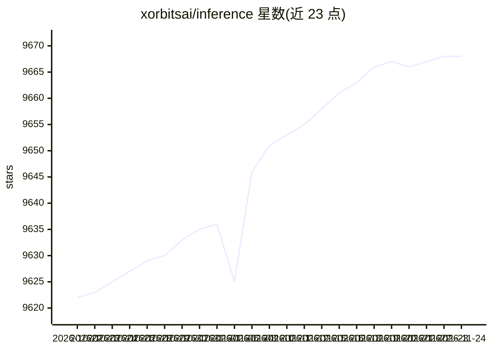

# xorbitsai/inference

⭐ 9,667 · Python · Apache-2.0 · 推送 2026-11-23 · [GitHub](https://github.com/xorbitsai/inference) · [官网](https://inference.readthedocs.io) · 组织维护 · 中文 README

**面向开发者的分布式模型推理平台：部署并通过 OpenAI 兼容 API 提供多模态模型**

Xinference 是开源分布式推理平台：内置 300+ 语言、视觉、嵌入、重排、图像、音频、视频模型目录，支持注册自定义模型（含 Flexible 类型的传统 ML 模型）。可选择 vLLM、SGLang、TRT-LLM、Transformers、llama.cpp、MLX 等引擎部署，硬件覆盖 CPU、GPU、Apple Silicon 与 MLU，支持单机到多节点分布式、prefill/decode 分离、同一模型 ID 下多引擎副本与滚动重配置。通过 Web UI、CLI 或 Python SDK 管理部署，经 OpenAI/Anthropic 兼容端点调用，Web UI 内置性能基准测试。另有企业版/云托管形态。

## 筛选速览

| 维度 | 判定 | 备注 |
|---|---|---|
| AI 角色 | `ai-ecosystem` | LLM/agent 周边工具 |
| 许可风险 | `permissive` | Apache-2.0 |
| 部署形态 | `self-host` | docker 或自建部署 |
| 模型依赖 | local-ok | 支持本地模型 |
| 硬件要求 | — | 无带数字的原话,不猜 |
| 安装摩擦 | `low` | 无编译、无系统依赖或容器化 |
| 成熟度 | — | 结构信号不足 |

## 能力要点

- 300+ 内置模型目录，覆盖语言、视觉、嵌入、重排、图像、音频、视频
- 多引擎后端（vLLM/SGLang/TRT-LLM/Transformers/llama.cpp/MLX）与异构硬件部署
- OpenAI/Anthropic 兼容端点，支持流式与工具调用
- 单机到分布式集群，支持 P/D 分离与 GPU 权重复用

## 适用场景

- 在笔记本或自有服务器上自托管模型并通过 API 接入应用
- 在集群中部署大模型并跨 worker 分摊推理
- 通过 Web UI 对运行中的模型做吞吐与延迟基准测试
- 为 LangChain/Dify/RAGFlow 等框架提供模型后端

## 场景标签

`推理引擎` · 领域:训练与推理

## 证据(README 行号)

> L3: **Xinference (Xorbits Inference) is an open-source distributed inference platform.**
> L63: |Engines and hardware|Choose vLLM, SGLang, TRT-LLM, Transformers, llama.cpp, or MLX for supported LLMs. Hardware su
> L65: |APIs and tools|OpenAI- and Anthropic-compatible endpoints, with streaming and tool calling where supported. Deploy

## 星数曲线

2026-10-22 9,622 → 2026-11-24 9,668（+46）

---
*卡片 v1 · prompt 1.4 · 生成 2026-11-22 · 置信度 high · 依据 README sha `96e17005c280` · [字段定义](../../DATASET.md)*
