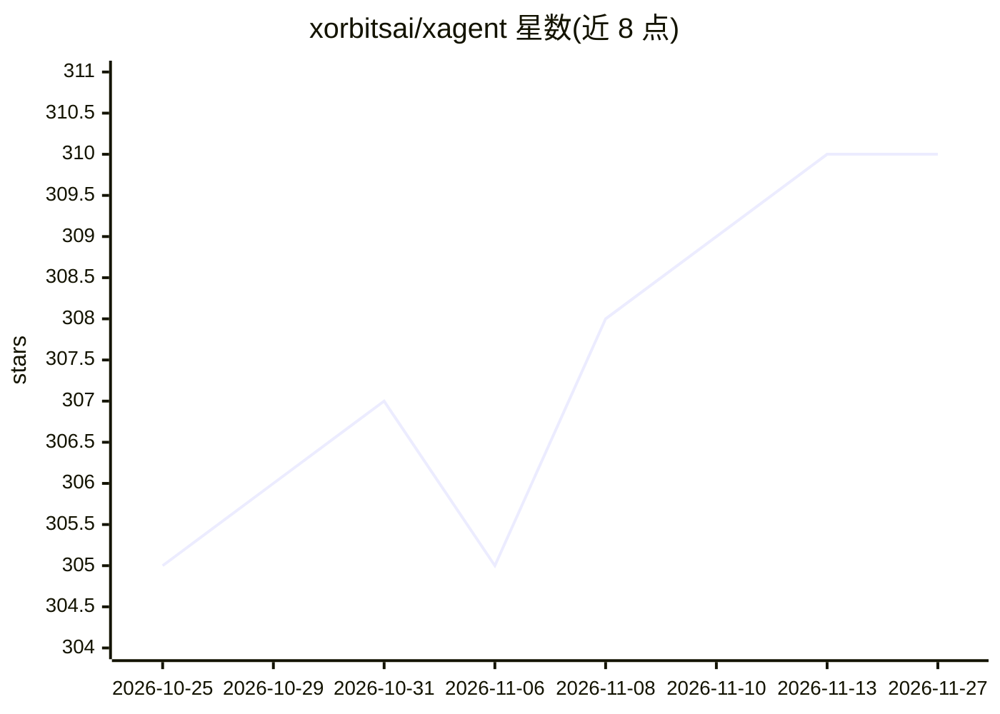

# xorbitsai/xagent

⭐ 310 · Python · NOASSERTION · 推送 2026-11-26 · [GitHub](https://github.com/xorbitsai/xagent) · [官网](https://docs.xagent.co) · 组织维护

**企业自托管 agent 平台：构建、部署并运营 AI teammate**

Xagent 是可自托管的企业级 agent 平台，将面向特定岗位的可复用 agent（teammate）集中配置模型、技能、工具与知识库，在工作区直接执行任务。发布路径覆盖分享链接、嵌入式 widget 与 REST API，支持定时运行、webhook、含 manager agent 的 Workforce 多专家协作，并提供会话日志、执行 trace 与工具沙箱用于运维审查。模型可接 API 提供商或经 Xinference 自托管。Python 3.11+ 提供 uv 安装包（含 Web UI），另支持 Docker Compose 部署；许可证为 source-available 而非 OSI 开源许可。

## 筛选速览

| 维度 | 判定 | 备注 |
|---|---|---|
| AI 角色 | `ai-ecosystem` | LLM/agent 周边工具 |
| 许可风险 | `none` | NOASSERTION |
| 部署形态 | `self-host` | docker 或自建部署 |
| 模型依赖 | — | README 未给出锁定关系 |
| 硬件要求 | — | 无带数字的原话,不猜 |
| 安装摩擦 | `low` | 无编译、无系统依赖或容器化 |
| 成熟度 | — | 结构信号不足 |

## 能力要点

- teammate 集中配置模型、技能、工具与知识库，可发布复用
- 三种交付入口：分享链接、嵌入式 widget、REST API（agent API key）
- Workforce 多 agent 协作与 manager agent 分工
- 会话日志、执行 trace 与工具沙箱的可观测运维

## 适用场景

- 把产品支持客服 agent 发布给同事或客户使用
- 将重复性工作流做成定时运行的 teammate
- 自托管部署并按用户账号管理团队内 agent

## 场景标签

`多智能体` `工作流自动化` `LLM 可观测性` `AI 助手` · 领域:Agent 开发

## 证据(README 行号)

> L21: Xagent is a self-hostable platform for **AI teammates**. A teammate is a reusable agent configured for a specific j
> L72: - **Models.** Connect supported API providers or serve your own models through Xinference.

## 星数曲线

2026-10-25 305 → 2026-11-27 310（+5）

---
*卡片 v1 · prompt 1.4 · 生成 2026-11-25 · 置信度 high · 依据 README sha `67b5a45b2d26` · [字段定义](../../DATASET.md)*
