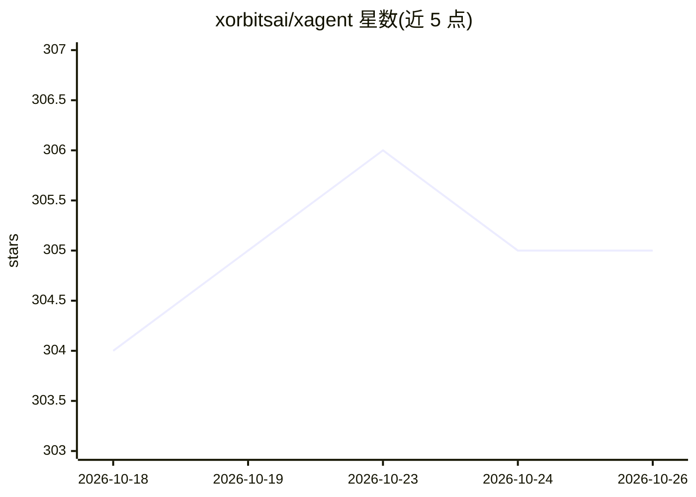

# xorbitsai/xagent

⭐ 305 · Python · NOASSERTION · 推送 2026-10-25 · [GitHub](https://github.com/xorbitsai/xagent) · [官网](https://docs.xagent.co) · 组织维护 · 中文 README

**面向个人到企业的自主代理运行平台：描述目标即完成工作**

Xagent 是一个 agentic 执行运行时：用户描述任务目标，平台的规划引擎在运行时分解任务、选择工具与模型，通过 Planner/Research/Data 等多角色代理协作产出交付物，并提供实时进度追踪与 Token 用量监控。支持三种使用方式：个人一次性任务、团队可复用代理（角色、知识库、模板、发布），以及企业自托管部署。模型接入支持 OpenAI、Claude、DeepSeek、智谱等 API 提供商及经 Xinference 的自托管模型；工具层支持文件、API、RAG 知识库与 MCP。Python 包自带 Web UI（Python 3.11+），另提供 Docker Compose 自托管方式。采用 Xagent Source License（非标准开源许可，条款见 LICENSE 文件）。

## 筛选速览

| 维度 | 判定 | 备注 |
|---|---|---|
| AI 角色 | `ai-ecosystem` | LLM/agent 周边工具 |
| 许可风险 | `none` | NOASSERTION |
| 部署形态 | `self-host` | docker 或自建部署 |
| 模型依赖 | locked-api |  |
| 硬件要求 | — | 无带数字的原话,不猜 |
| 安装摩擦 | `low` | 无编译、无系统依赖或容器化 |
| 成熟度 | — | 结构信号不足 |

## 能力要点

- 运行时动态规划：任务分解、Plan→Execute→Reflect 循环、条件执行
- 多代理协作编组（Planner/Research/Data/Writing 等角色）
- 支持 API 模型（OpenAI/Claude/DeepSeek/智谱）与 Xinference 自托管模型
- 知识库/RAG、MCP 工具接入，任务生命周期与 Token 用量监控，多用户与可选沙箱执行

## 适用场景

- 把研究、写作、数据分析等日常任务交给个人代理执行
- 把团队重复性工作固化为可发布复用的代理
- 企业私有化部署代理平台，接入自有模型、知识库与内部系统

## 场景标签

`多智能体` `Agent 框架` `数据分析` · 领域:Agent 开发

## 证据(README 行号)

> L94: Xagent is an agent platform for personal work, reusable team agents, and enterprise AI systems.
> L307: |**Planning engine**|Runtime decomposition, planning, reflection, and iteration|
> L310: |**Model layer**|API-based models and self-hosted models via Xinference|

## 星数曲线

2026-10-18 304 → 2026-10-26 305（+1）

---
*卡片 v1 · prompt 1.4 · 生成 2026-10-22 · 置信度 high · 依据 README sha `adebec8aa138` · [字段定义](../../DATASET.md)*
