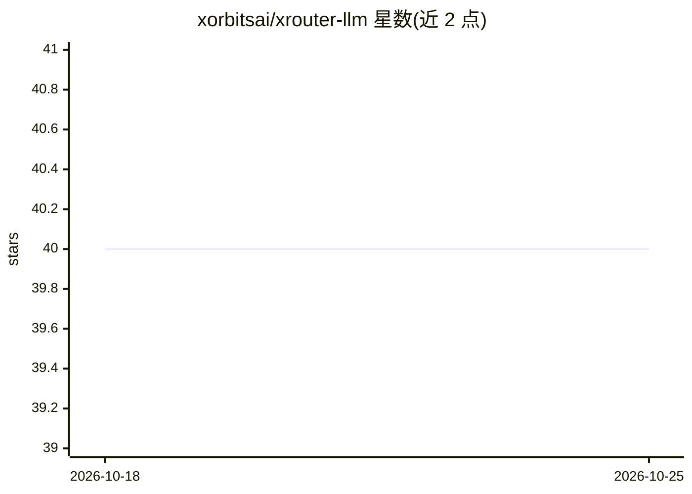

# xorbitsai/xrouter-llm

⭐ 40 · Python · NOASSERTION · 推送 2026-10-10 · [GitHub](https://github.com/xorbitsai/xrouter-llm) · 组织维护 · 中文 README

**提示感知的 LLM 路由决策服务：预测并选出最便宜可完成的模型**

由 Xorbits 维护的 LLM 路由决策服务：基于 IRT 式模型，用多语言嵌入（Qwen3-Embedding-0.6B）回归提示难度、结合模型公开基准分数估计完成概率，再按策略选择通过完成阈值的最便宜模型。它只输出路由决策并记录到 SQLite，不调用底层 LLM。以 pip 包形式发布，内置训练好的路由器、模型注册表（YAML，含价格/上下文/基准）与命名 auto configs，提供 HTTP API 与单页 Web UI；也支持自选 Xinference 或 sentence-transformers 嵌入后端重训。限制：难度模型主要在编码/终端任务数据上训练，其他任务类型需自补数据。

## 筛选速览

| 维度 | 判定 | 备注 |
|---|---|---|
| AI 角色 | `ai-ecosystem` | LLM/agent 周边工具 |
| 许可风险 | `none` | NOASSERTION |
| 部署形态 | `library` | 以包/库形式分发 |
| 模型依赖 | — | README 未给出锁定关系 |
| 硬件要求 | — | 无带数字的原话,不猜 |
| 安装摩擦 | `low` | 无编译、无系统依赖或容器化 |
| 成熟度 | — | 结构信号不足 |

## 能力要点

- IRT 式分解：P(complete)=sigmoid(a·capability+b·difficulty+c)，难度用 Ridge 回归嵌入向量
- 仅做路由决策不调用 LLM，每次决策记录到 SQLite
- 包内捆绑训练好的路由器、模型能力注册表（34+ profiles）与 auto configs，装好即用
- 支持 Xinference /v1/embeddings 端点与运行时后端重绑

## 适用场景

- 在调用 LLM 前决定把请求发给哪个模型以降低成本
- 用自己的流量数据重训路由器并诊断成本/完成率前沿
- 按输入模态偏好过滤候选模型集

## 场景标签

 · 领域:LLM 基础设施/模型路由

## 证据(README 行号)

> L9: `xrouter-llm` is a prompt-aware LLM **routing-decision** service: it predicts
> L14: It answers "which model should serve this prompt?" and records the choice — it
> L226: - `serving.py` / `server.py`: HTTP routing-decision API + single-page web UI.

## 星数曲线

2026-10-18 40 → 2026-10-25 40（+0）

---
*卡片 v1 · prompt 1.4 · 生成 2026-10-25 · 置信度 high · 依据 README sha `b1db9f91a27c` · [字段定义](../../DATASET.md)*
