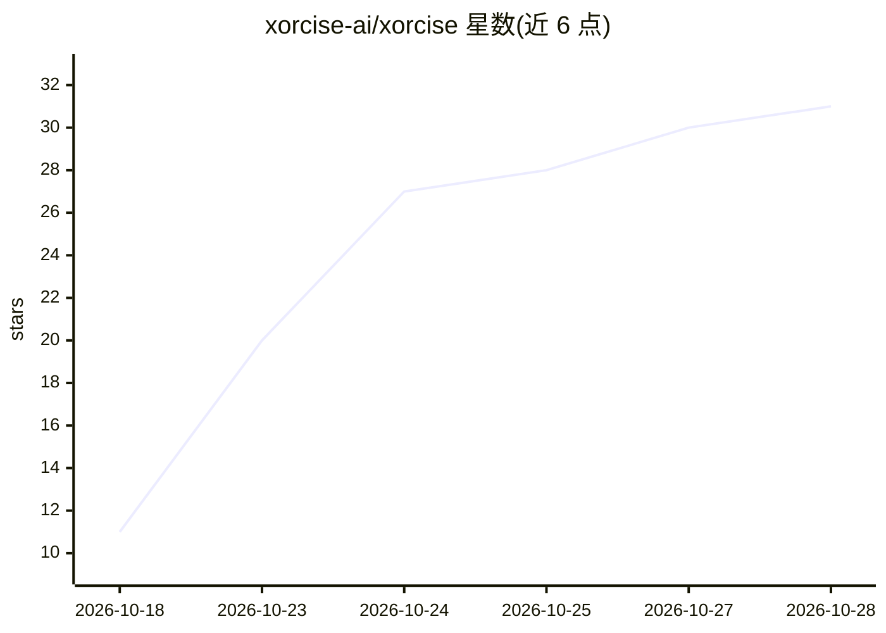

# xorcise-ai/xorcise

⭐ 31 · Python · NOASSERTION · 推送 2026-10-28 · [GitHub](https://github.com/xorcise-ai/xorcise) · [官网](https://xorcise.ai) · 组织维护

**网络安全 AI agent 实战评测平台：隔离环境执行任务并记录证据评分**

面向安全测试场景的 agent 评测引擎：让 cyber-AI agent 在隔离的 Docker 环境中执行真实任务（mission），以 OpenTelemetry 记录每条命令、工具调用与失败路径，用确定性检查加自带模型 judge 对证据评分，输出 trace、报告（Markdown/HTML/JSONL）与排行榜。支持 OpenHands、Claude Code、Codex CLI 及自定义 agent 接入。每次运行使用独立私有网络与一次性环境。任务目标刻意含漏洞（SQL 注入、IDOR 等），仅限自有或获书面授权的系统；商业托管层不开源。

## 筛选速览

| 维度 | 判定 | 备注 |
|---|---|---|
| AI 角色 | `ai-ecosystem` | LLM/agent 周边工具 |
| 许可风险 | `permissive` | NOASSERTION |
| 部署形态 | `library` | 以包/库形式分发 |
| 模型依赖 | — | README 未给出锁定关系 |
| 硬件要求 | — | 无带数字的原话,不猜 |
| 安装摩擦 | `low` | 无编译、无系统依赖或容器化 |
| 成熟度 | — | 结构信号不足 |

## 能力要点

- OpenTelemetry 记录 agent 全部命令、工具调用与消息形成 trace
- 确定性检查 + bring-your-own-model judge 双重评分
- 每次运行独立私有网络与一次性环境，agent 无法触达宿主机
- 支持 OpenHands/Claude Code/Codex CLI 及 REST 提交的自定义 agent

## 适用场景

- 评测我的安全 agent 在真实漏洞任务中的完整行为而非仅结果
- 审计 agent 过程中的破坏性命令与失败路径
- 跨多次运行对 agent 排名对比

## 场景标签

`模型评测` `网络安全` `LLM 可观测性` · 领域:评测与运维

## 证据(README 行号)

> L24: it tried on the way there. XORCISE runs the agent against a live target inside a contained
> L25: environment, records every command, tool call and dead end as OpenTelemetry evidence, and
> L62: |**Score**|deterministic checks plus a bring-your-own-model judge|

## 星数曲线

2026-10-18 11 → 2026-10-28 31（+20）

---
*卡片 v1 · prompt 1.4 · 生成 2026-10-26 · 置信度 high · 依据 README sha `6062eb5a6dba` · [字段定义](../../DATASET.md)*
