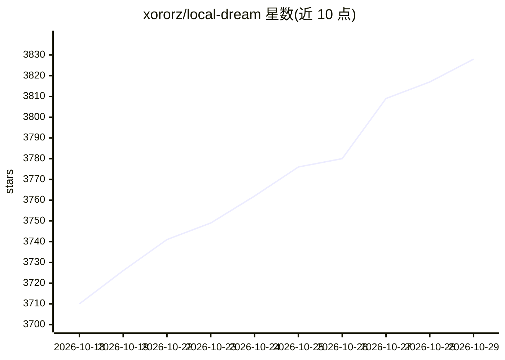

# xororz/local-dream

⭐ 3,828 · Kotlin · NOASSERTION · 推送 2026-10-20 · [GitHub](https://github.com/xororz/local-dream) · [官网](https://play.google.com/store/apps/details?id=io.github.xororz.localdream) · 个人维护 · 中文 README

**Android 端 Stable Diffusion 应用，支持骁龙 NPU 加速**

面向 Android 用户的本地 Stable Diffusion 图像生成应用（txt2img/img2img/inpainting），支持 Snapdragon NPU 加速推理，也支持 CPU/GPU 推理。NPU 支持限制：SD1.5 需 Hexagon V68 或更新架构，SDXL 需 Snapdragon 8 Gen 3 及以上；CPU/GPU 支持 SD1.5 与导入的 SDXL MNN 包，大 SDXL 模型内存占用显著更高。SD2.1 已不再维护。底层使用 Qualcomm QNN SDK、alibaba/MNN、stable-diffusion.cpp 等库；文档迁移至外部 Guide Site，仓库未直接给出安装命令。

## 筛选速览

| 维度 | 判定 | 备注 |
|---|---|---|
| AI 角色 | `ai-native` | 本体是模型或模型工具 |
| 许可风险 | `none` | NOASSERTION |
| 部署形态 | `None` |  |
| 模型依赖 | — | README 未给出锁定关系 |
| 硬件要求 | — | 无带数字的原话,不猜 |
| 安装摩擦 | `low` | 无编译、无系统依赖或容器化 |
| 成熟度 | — | 结构信号不足 |

## 能力要点

- Snapdragon NPU 加速的 Stable Diffusion 推理（SD1.5/SDXL）
- 同时支持 CPU/GPU 推理路径（MNN）
- 集成 Real-ESRGAN/UltraSharpV2 图像放大与 opennsfw2 NSFW 过滤

## 适用场景

- 在安卓手机上离线进行文生图/图生图/局部重绘
- 利用骁龙 NPU 加速端侧图像生成
- 对生成图像做放大与内容过滤

## 场景标签

`图像生成` · 领域:内容生成

## 证据(README 行号)

> L3: **Android Stable Diffusion with Snapdragon NPU acceleration**
> L15: > Currently focused on SD1.5 and SDXL models. SD2.1 is no longer maintained due to poor quality and limited popular

## 星数曲线

2026-10-18 3,710 → 2026-10-29 3,828（+118）

---
*卡片 v1 · prompt 1.4 · 生成 2026-10-20 · 置信度 high · 依据 README sha `d48bd93dc39f` · [字段定义](../../DATASET.md)*
