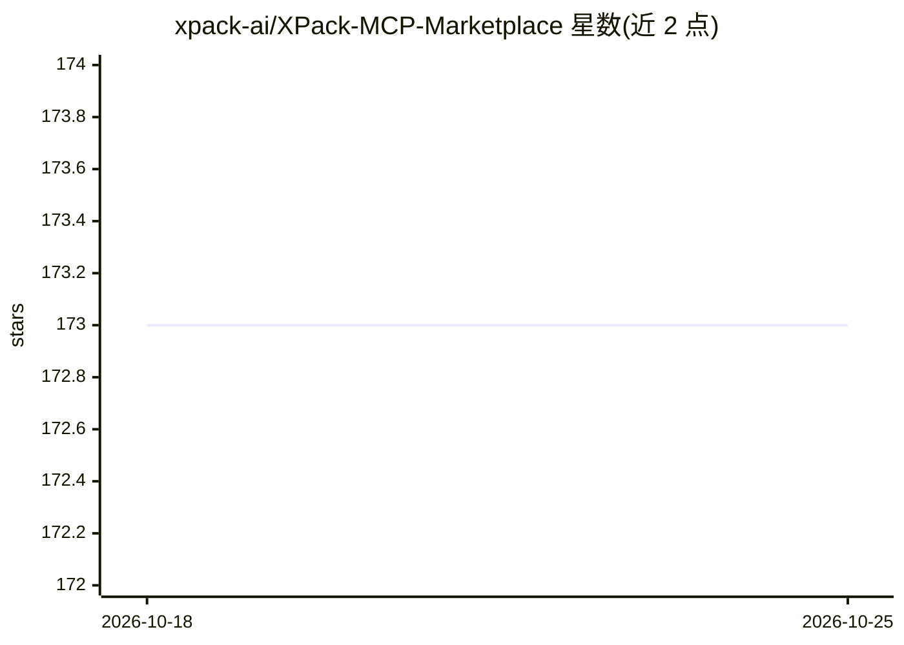

# xpack-ai/XPack-MCP-Marketplace

⭐ 173 · TypeScript · Apache-2.0 · 推送 2026-05-18 · [GitHub](https://github.com/xpack-ai/XPack-MCP-Marketplace) · [官网](https://xpack.ai) · 组织维护 · 中文 README

**开源自托管 MCP 交易市场平台，可快速上架并销售 MCP 服务**

XPack 是一个自托管的开源 MCP 市场建站平台：一键将 OpenAPI 转为 MCP 服务配置，生成 SEO 友好的首页与服务页，内置按调用次数或 token 用量的计费、Stripe 支付、用户账号管理、Email 与 Google OAuth 登录。面向想销售 MCP 服务的开发者与企业，提供 curl 一键部署脚本、Docker-Compose、源码构建三种途径；运行需 MySQL≥5.7、Redis≥6.2、RabbitMQ≥4.0，前端需 Node≥22/Pnpm≥10，后端需 Python≥3.11。Apache 2.0 许可。

## 筛选速览

| 维度 | 判定 | 备注 |
|---|---|---|
| AI 角色 | `ai-ecosystem` | LLM/agent 周边工具 |
| 许可风险 | `permissive` | Apache-2.0 |
| 部署形态 | `self-host` | docker 或自建部署 |
| 模型依赖 | — | README 未给出锁定关系 |
| 硬件要求 | — | 无带数字的原话,不猜 |
| 安装摩擦 | `low` | 无编译、无系统依赖或容器化 |
| 成熟度 | — | 结构信号不足 |

## 能力要点

- 一键 OpenAPI → MCP 服务配置
- 内置按调用或 token 用量的计费与 Stripe 支付
- 用户账号管理与 Email/Google OAuth 登录
- 提供一键脚本、Docker-Compose 与源码构建三种部署方式

## 适用场景

- 搭建自己的 MCP 商店并上架销售 MCP 服务
- 为 OpenAPI 服务生成 MCP 服务页面并按用量收费
- 企业内部自托管 MCP 服务目录与账号管理

## 场景标签

 · 领域:MCP/Agent 生态基础设施

## 证据(README 行号)

> L20: **XPack** is the world’s first open-source MCP marketplace, to quickly create and sell your own MCP services in jus
> L23: - ✅ **One-click OpenAPI → MCP service config**
> L25: - 💳 **Built-in billing (per-call or token usage)**

## 星数曲线

2026-10-18 173 → 2026-10-25 173（+0）

---
*卡片 v1 · prompt 1.4 · 生成 2026-10-22 · 置信度 mid · 依据 README sha `c299c1efc211` · [字段定义](../../DATASET.md)*
