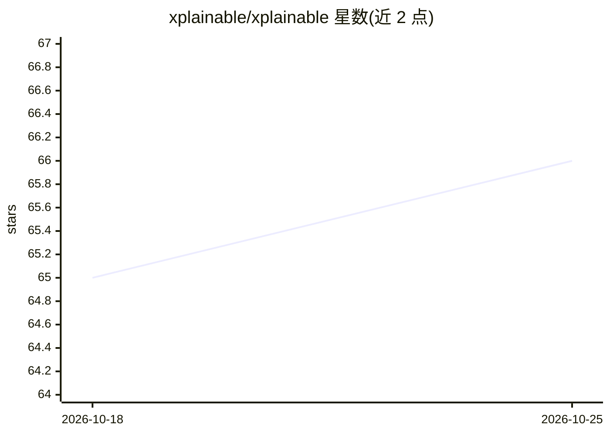

# xplainable/xplainable

⭐ 66 · Python · AGPL-3.0 · 推送 2026-07-23 · [GitHub](https://github.com/xplainable/xplainable) · [官网](https://www.xplainable.io) · 组织维护

**表格机器学习库：模型自带逐特征贡献的实时可解释预测**

面向商业优化的 Python 表格机器学习库，提供二分类（XClassifier）、回归（XRegressor）及分区版本模型，每次预测附带精确的逐特征贡献分（非估算）。附带贝叶斯超参优化、单特征快速调参与 JSON 可序列化的预处理管线包（xplainable-preprocessing），另有 xplainable-client 用于云端部署协作。README 称其算法效果对标 XGBoost/LightGBM 等黑盒模型，区别在于设计即内置可解释性。

## 筛选速览

| 维度 | 判定 | 备注 |
|---|---|---|
| AI 角色 | `ai-native` | 本体是模型或模型工具 |
| 许可风险 | `viral` | AGPL-3.0 |
| 部署形态 | `library` | 以包/库形式分发 |
| 模型依赖 | — | README 未给出锁定关系 |
| 硬件要求 | — | 无带数字的原话,不猜 |
| 安装摩擦 | `low` | 无编译、无系统依赖或容器化 |
| 成熟度 | — | 结构信号不足 |

## 能力要点

- 设计即内置可解释性：每个预测附精确的逐特征贡献分
- 支持二分类/回归及分区模型，配贝叶斯超参优化器
- 可按单特征快速调参而无需整体重训
- 预处理管线为 spec 驱动、JSON 可序列化，支持版本化

## 适用场景

- 训练带解释的流失预测或信用风险模型
- 用逐特征贡献定位可干预的业务杠杆并估算干预价值
- 构建可持久化、可复现的表格数据预处理管线

## 场景标签

 · 领域:机器学习/数据科学

## 证据(README 行号)

> L19: Every prediction comes with per-feature contribution scores that explain *why* the model made that decision. These 
> L50: |Binary Classification|`XClassifier`|

## 星数曲线

2026-10-18 65 → 2026-10-25 66（+1）

---
*卡片 v1 · prompt 1.4 · 生成 2026-10-24 · 置信度 high · 依据 README sha `a952d4627498` · [字段定义](../../DATASET.md)*
