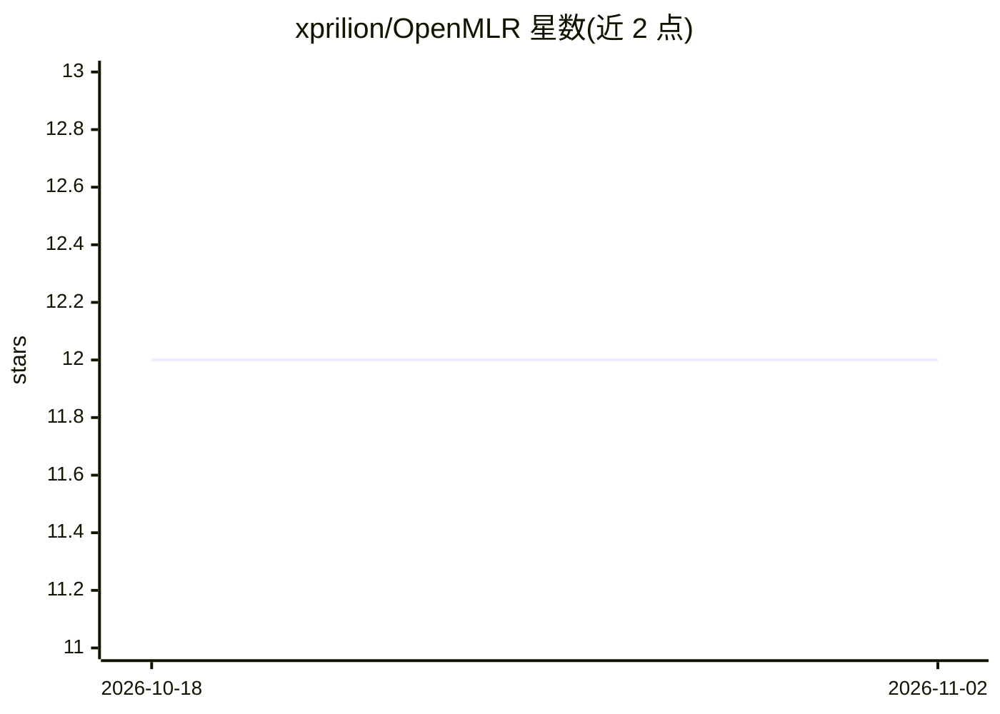

# xprilion/OpenMLR

⭐ 12 · Python · MIT · 推送 2026-08-20 · [GitHub](https://github.com/xprilion/OpenMLR) · [官网](https://openmlr.dev) · 个人维护

**自托管的 ML 研究助手：规划任务、读论文、写稿、跑实验**

可自部署的机器学习研究 agent 应用：在单一对话中做任务规划（Plan）与执行（Execute），通过 OpenAlex、Semantic Scholar、arXiv 等来源检索并阅读论文、爬取引用图，逐节撰写论文草稿并导出 Markdown/LaTeX。支持多 LLM 提供商（OpenAI、Anthropic、OpenRouter、Ollama、LM Studio 等），代码可在本地 Docker、SSH 远程或 Modal 云上执行；提供持久化工作区、知识图谱、内置终端与 MCP 服务器接入。以 Docker Compose 或源码方式部署。

## 筛选速览

| 维度 | 判定 | 备注 |
|---|---|---|
| AI 角色 | `ai-native` | 本体是模型或模型工具 |
| 许可风险 | `permissive` | MIT |
| 部署形态 | `self-host` | docker 或自建部署 |
| 模型依赖 | local-ok | 支持本地模型 |
| 硬件要求 | — | 无带数字的原话,不猜 |
| 安装摩擦 | `low` | 无编译、无系统依赖或容器化 |
| 成熟度 | — | 结构信号不足 |

## 能力要点

- Plan/Execute 双模式 agent，单一对话完成研究与执行
- 多源论文检索（OpenAlex/Semantic Scholar/arXiv/CrossRef）与引用图爬取
- 计算环境支持本地 Docker、SSH 远程与 Modal 云
- 多 LLM 提供商接入，含 Ollama/LM Studio 本地模型与 LiteLLM 兼容

## 适用场景

- 自助完成文献调研与论文初稿撰写
- 在对话中规划并远程/容器内执行 ML 实验
- 搭建团队自有的 AI 科研工作台

## 场景标签

`科研工具` `AI 写作` · 领域:内容生成

## 证据(README 行号)

> L5:  A self-hosted ML research agent that plans, researches, writes papers, and executes code — all in one conversation.
> L23: - **Multi-provider LLMs** — OpenAI, Anthropic, OpenRouter, plus local models (Ollama, LM Studio). Add custom provid

## 星数曲线

2026-10-18 12 → 2026-11-02 12（+0）

---
*卡片 v1 · prompt 1.4 · 生成 2026-10-31 · 置信度 high · 依据 README sha `9fddbda9a437` · [字段定义](../../DATASET.md)*
