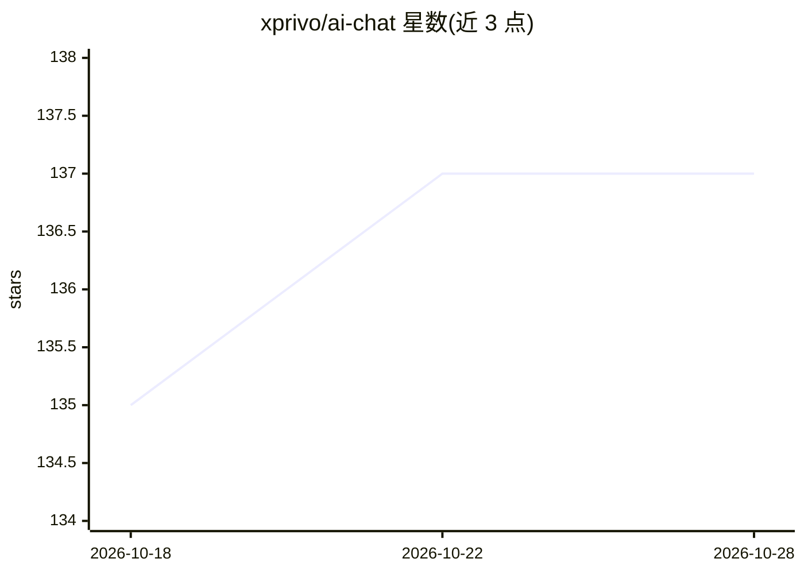

# xprivo/ai-chat

⭐ 137 · TypeScript · AGPL-3.0 · 推送 2026-05-06 · [GitHub](https://github.com/xprivo/ai-chat) · [官网](https://www.xprivo.com/) · 组织维护

**可自托管的隐私优先 AI 聊天界面，自带 API key 即用**

开源 AI 聊天界面，README 自称 ChatGPT/Perplexity 的替代品。数据存储在浏览器本地，无需账号；可接入任意 OpenAI 兼容 API 端点（本地或外部模型），也提供 xprivo.com 托管版（免费层带广告、PRO 付费无广告）。功能含流式对话、文件上传（PDF/CSV/Excel/DOC，上限 10MB）、工作区、AI 专家助手、网页搜索、多语言界面。自托管需 Node.js 18+，克隆仓库 npm 安装运行；React 18 + Vite + Tailwind 技术栈，AGPLv3 许可。外部端点可能遇 CORS 问题，需自建后端代理。

## 筛选速览

| 维度 | 判定 | 备注 |
|---|---|---|
| AI 角色 | `ai-native` | 本体是模型或模型工具 |
| 许可风险 | `viral` | AGPL-3.0 |
| 部署形态 | `None` |  |
| 模型依赖 | — | README 未给出锁定关系 |
| 硬件要求 | — | 无带数字的原话,不猜 |
| 安装摩擦 | `low` | 无编译、无系统依赖或容器化 |
| 成熟度 | — | 结构信号不足 |

## 能力要点

- 数据全部本地存储于浏览器，无需账号
- 接入任意 OpenAI 兼容 API 端点（本地或外部模型）
- 文件上传讨论（PDF/CSV/Excel/DOC，默认 10MB 上限）与工作区组织
- 支持自托管或使用 xprivo.com 托管版

## 适用场景

- 用自己的 API key 进行私密 AI 对话，不在服务商处留存聊天记录
- 自托管部署一个可自定义品牌的聊天界面给团队使用
- 在同一界面中切换多个本地或外部模型

## 场景标签

`AI 助手` `聊天机器人` · 领域:对话与助手

## 证据(README 行号)

> L5: xPrivo is an open-source AI chat interface and an alternative to ChatGPT/Perplexity that prioritises privacy and con
> L34: - **Privacy-First**: All data stored locally in your browser. No servers, no tracking
> L45: - **Modern chat interface** with real-time streaming responses

## 星数曲线

2026-10-18 135 → 2026-10-28 137（+2）

---
*卡片 v1 · prompt 1.4 · 生成 2026-10-22 · 置信度 high · 依据 README sha `0e60e389cc1f` · [字段定义](../../DATASET.md)*
