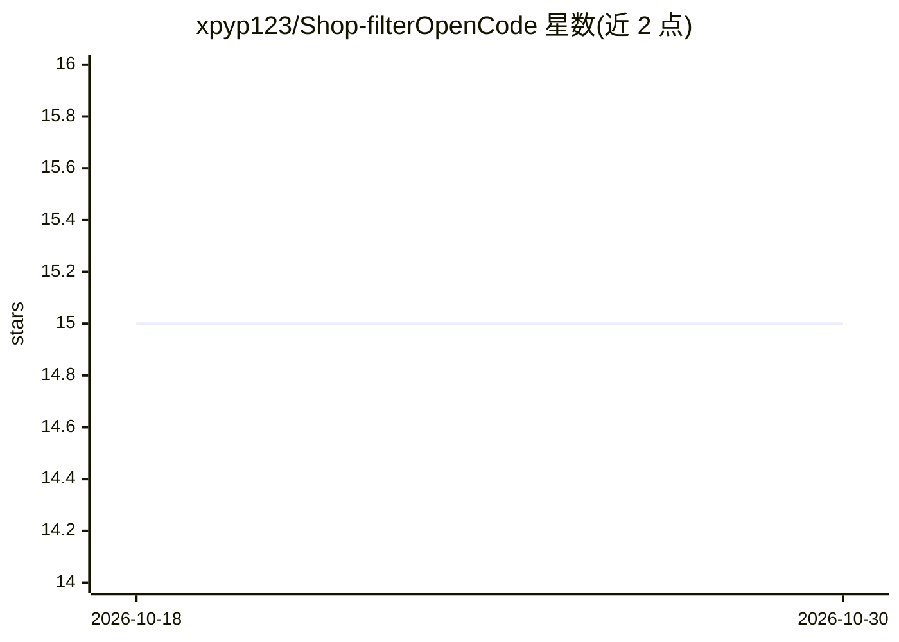

# xpyp123/Shop-filterOpenCode

⭐ 15 · C++ · 推送 2026-05-01 · [GitHub](https://github.com/xpyp123/Shop-filterOpenCode) · 个人维护 · 中文 README

**Qt6/C++17 电商商品多平台聚合与加权排序选品桌面应用**

基于 Qt6 + C++17 的桌面应用：输入关键词后由多平台并发抓取商品数据，解析价格、评分、销量、折扣、包邮、库存等维度，经可配置规则筛选（价格区间、最低评分、免邮）后，按自述的 MWCE 加权公式（价格 35%/口碑 30%/热度 20%/折扣 15%）计算综合评分并排序输出。架构上采用插件式 IScraper 抓取接口与多线程并发。README 声明全程由 OpenCode AI 智能体辅助开发，运行时功能本身为规则计算与抓取。需自行编译：Qt>=6.0、CMake>=3.16、C++17 编译器。

## 筛选速览

| 维度 | 判定 | 备注 |
|---|---|---|
| AI 角色 | `ai-enhanced` | 去掉 AI 部分产品仍成立 |
| 许可风险 | `none` | — |
| 部署形态 | `None` |  |
| 模型依赖 | — | README 未给出锁定关系 |
| 硬件要求 | — | 无带数字的原话,不猜 |
| 安装摩擦 | `medium` | 含编译或系统依赖之一 |
| 成熟度 | — | 结构信号不足 |

## 能力要点

- 多平台插件式抓取（IScraper 接口）+ 多线程并发
- MWCE 四维加权综合评分模型排序
- 可配置筛选规则：价格区间、最低评分、免邮等
- 跨平台数据统一清洗去噪后同台排序

## 适用场景

- 输入关键词后自动跨平台比对商品价格与口碑
- 按价格/评分/免邮等条件批量筛选候选商品
- 依据综合评分模型快速得到购买决策排序

## 场景标签

`网页抓取` · 领域:效率与自动化

## 证据(README 行号)

> L9: 基于 **Qt6 + C++17** 构建，你只需告诉它要什么，剩下的搜索、比对、排序、筛选全自动完成。
> L21: |智能决策|内置加权综合评分模型，自动计算商品性价比|
> L66: |开发|OpenCode AI 智能体辅助|

## 星数曲线

2026-10-18 15 → 2026-10-30 15（+0）

---
*卡片 v1 · prompt 1.4 · 生成 2026-10-30 · 置信度 high · 依据 README sha `636550b80d49` · [字段定义](../../DATASET.md)*
