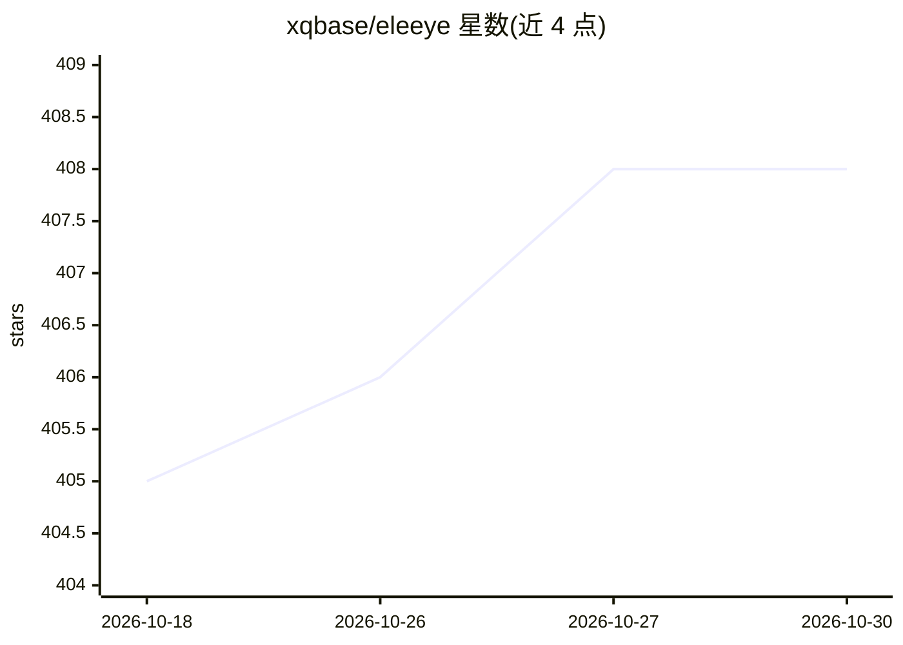

# xqbase/eleeye

⭐ 408 · C++ · LGPL-2.1 · 推送 2026-10-23 · [GitHub](https://github.com/xqbase/eleeye) · [官网](http://www.xqbase.com/) · 个人维护 · 中文 README

**中国象棋对弈引擎（象眼），供 UCCI 界面调用下棋与分析**

ElephantEye（象眼）是基于 LGPL 协议的中国象棋引擎程序，实现 UCCI 3.0 协议，需在支持 UCCI 的界面软件（如象棋巫师）下运行。搜索部分采用递归式 Alpha-Beta 主要变例搜索、置换表、空着裁剪、迭代加深等算法，内置含 10,000 个对称局面着法的开局库，搜索与局面评价两部分作为独立程序库发布，供其他程序设计师按 LGPL 复用。附带开局库制作工具、引擎联赛模拟器、棋谱转换等附加模块。

## 筛选速览

| 维度 | 判定 | 备注 |
|---|---|---|
| AI 角色 | `ai-native` | 本体是模型或模型工具 |
| 许可风险 | `viral` | LGPL-2.1 |
| 部署形态 | `desktop` | 安装包/桌面程序 |
| 模型依赖 | — | README 未给出锁定关系 |
| 硬件要求 | — | 无带数字的原话,不猜 |
| 安装摩擦 | `low` | 无编译、无系统依赖或容器化 |
| 成熟度 | — | 结构信号不足 |

## 能力要点

- 实现 UCCI 3.0 引擎协议，可被象棋巫师等界面调用
- Alpha-Beta 主要变例搜索、双层置换表、带检验的空着裁剪
- 内置从 1990-2005 年约 8,000 局顶尖比赛提取的 10,000 着法开局库
- 搜索与局面评价分离为独立程序库，可单独复用

## 适用场景

- 配合象棋巫师等 UCCI 界面进行人机对弈或局面分析
- 象棋程序设计师复用其搜索或局面评价库开发自己的引擎
- 用附带的开局库制作工具生成自定义开局库

## 场景标签

 · 领域:棋类博弈/游戏

## 证据(README 行号)

> L16:  ElephantEye 支持UCCI 3.0，浅红象棋用户可通过UCCI引擎适配器(UCCI2QH)调用ElephantEye引擎。
> L61:  ElephantEye 属于偏向蛮力的象棋程序，使用了严谨而有效的博弈算法：

## 星数曲线

2026-10-18 405 → 2026-10-30 408（+3）

---
*卡片 v1 · prompt 1.4 · 生成 2026-10-21 · 置信度 high · 依据 README sha `5b3b378ed4fe` · [字段定义](../../DATASET.md)*
