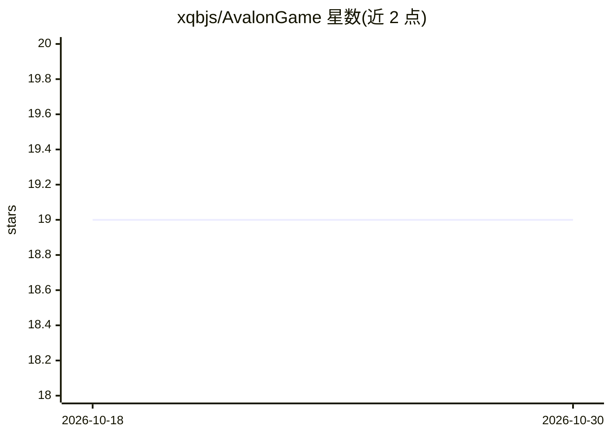

# xqbjs/AvalonGame

⭐ 19 · Python · Apache-2.0 · 推送 2026-01-26 · [GitHub](https://github.com/xqbjs/AvalonGame) · 个人维护 · 中文 README

**网页版阿瓦隆对局平台：人机混战与远程联机**

基于 FastAPI 与 WebSocket 的网页版阿瓦隆（The Resistance: Avalon）实现，支持 5-10 人标准配置、纯人类/人机混合/自定义人数模式，含断线重连状态恢复与热重开。AI 部分由 OpenAI 兼容格式的 LLM（如 Qwen-Max）驱动 agent 参与对局，读取聊天记录推理（可被提示注入影响），赛后读取全量对局日志生成复盘分析；另附基于 PPO 的 RL 训练框架（agentevolver）。配置 API 端点后 python -m games.web.server 启动，可用 ngrok/frp 等隧道实现远程联机。Apache 许可，非商业粉丝实现。

## 筛选速览

| 维度 | 判定 | 备注 |
|---|---|---|
| AI 角色 | `ai-enhanced` | 去掉 AI 部分产品仍成立 |
| 许可风险 | `permissive` | Apache-2.0 |
| 部署形态 | `library` | 以包/库形式分发 |
| 模型依赖 | — | README 未给出锁定关系 |
| 硬件要求 | — | 无带数字的原话,不猜 |
| 安装摩擦 | `low` | 无编译、无系统依赖或容器化 |
| 成熟度 | — | 结构信号不足 |

## 能力要点

- 人机混合多人对局（纯人类/3人+2AI训练/自定义混编）
- LLM agent 读取聊天记录推理，debug 模式可查看 Thinking-ReAct 日志
- 赛后 AI 读取完整对局日志做复盘分析
- 附 PPO 强化学习训练入口（agentevolver/main_ppo.py）

## 适用场景

- 和好友远程开一局阿瓦隆，手机电脑都能玩
- 人数不够时加入 LLM AI agent 凑局或练习欺骗技巧
- 训练自定义 RL agent 参与对局
- 赛后查看 AI 对全场发言与投票的复盘分析

## 场景标签

`强化学习` · 领域:训练与推理

## 证据(README 行号)

> L35: - **Full Human Mode**: Classic 10-player chaos.
> L10: **Supports Human vs. AI hybrid gameplay and seamless remote multiplayer.**

## 星数曲线

2026-10-18 19 → 2026-10-30 19（+0）

---
*卡片 v1 · prompt 1.4 · 生成 2026-10-28 · 置信度 mid · 依据 README sha `1116090a9484` · [字段定义](../../DATASET.md)*
