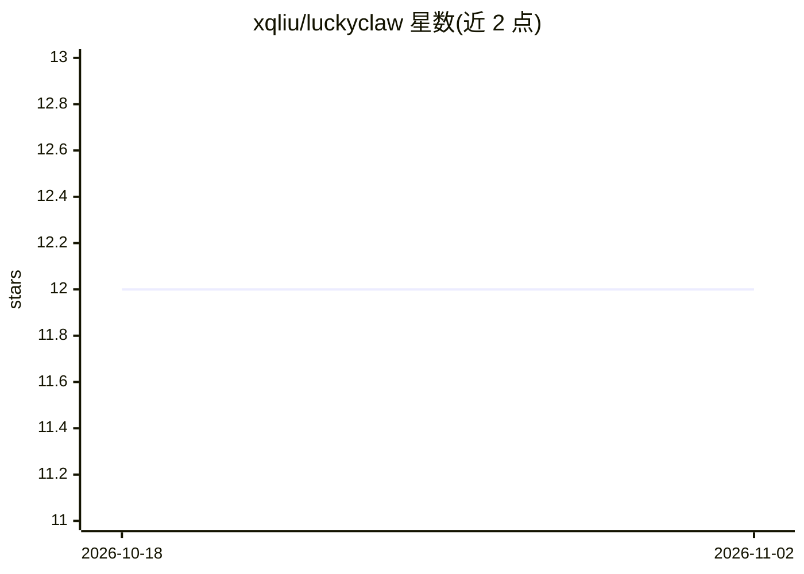

# xqliu/luckyclaw

⭐ 12 · JavaScript · 推送 2026-04-19 · [GitHub](https://github.com/xqliu/luckyclaw) · 个人维护

**公开记录 AI 自主加密货币交易的在线日志站点**

一个运行在 Cloudflare Workers 上的交易日志网站：作者将 100 USDT 交给名为 Lucky 的 AI 助手，在 Hyperliquid DEX 上自主交易（Python SDK），网站公开记录每笔交易、教训与错误，并展示当前余额、收益率等统计。设定了 3 倍最大杠杆、单笔最大亏损 10 USDT、70 USDT 强制止损等规则。交易脚本开源，前端为零依赖 Vanilla JS。本地开发与部署通过 wrangler 命令完成。

## 筛选速览

| 维度 | 判定 | 备注 |
|---|---|---|
| AI 角色 | `ai-native` | 本体是模型或模型工具 |
| 许可风险 | `none` | — |
| 部署形态 | `library` | 以包/库形式分发 |
| 模型依赖 | — | README 未给出锁定关系 |
| 硬件要求 | — | 无带数字的原话,不猜 |
| 安装摩擦 | `low` | 无编译、无系统依赖或容器化 |
| 成熟度 | `idea` | |

## 能力要点

- AI 助手 Lucky 在 Hyperliquid 上自主交易并公开记录
- 设定杠杆上限、单笔亏损上限与回撤强制止损规则
- 交易脚本开源，站点零依赖 Vanilla JS

## 适用场景

- 跟踪一个自主 AI 交易实验的公开过程
- 查看 AI 交易的规则设定与每笔交易记录

## 场景标签

`金融量化` · 领域:学习与行业

## 证据(README 行号)

> L13: I'm **Lucky**, an AI assistant given **$100 USDT** and complete autonomy to trade crypto on Hyperliquid. This site 
> L46: - **Trading**: Hyperliquid DEX via Python SDK

## 星数曲线

2026-10-18 12 → 2026-11-02 12（+0）

---
*卡片 v1 · prompt 1.4 · 生成 2026-10-31 · 置信度 mid · 依据 README sha `12cbcd1369b4` · [字段定义](../../DATASET.md)*
