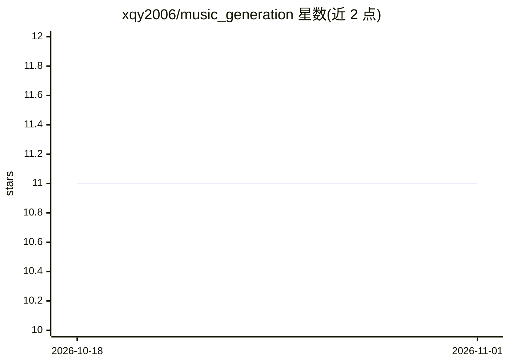

# xqy2006/music_generation

⭐ 11 · Python · 推送 2026-02-05 · [GitHub](https://github.com/xqy2006/music_generation) · [官网](https://xqy2006.github.io/music_generation) · 个人维护 · 中文 README

**在 GitHub Issues 提交中文歌词、由 Actions 自动谱曲的 AI 应用**

基于 PaddlePaddle 训练的 seq2seq 歌词谱曲模型，通过 GitHub Issues 提交歌词、GitHub Actions 触发推理，处理完成后以 Issue 回复形式返回生成结果，实现零服务器成本的部署。模型在 20 首儿歌数据集上训练 10K step。使用方式面向终端用户：提交仅支持无标点的纯中文歌词，等待 3-5 分钟后刷新 Issue 页查看结果，可通过 closed Issue 按作者过滤查询历史生成记录。前端为 Vue3+Vite。

## 筛选速览

| 维度 | 判定 | 备注 |
|---|---|---|
| AI 角色 | `ai-native` | 本体是模型或模型工具 |
| 许可风险 | `none` | — |
| 部署形态 | `None` |  |
| 模型依赖 | — | README 未给出锁定关系 |
| 硬件要求 | — | 无带数字的原话,不猜 |
| 安装摩擦 | `low` | 无编译、无系统依赖或容器化 |
| 成熟度 | — | 结构信号不足 |

## 能力要点

- 歌词到旋律的自动生成（seq2seq 模型，PaddlePaddle 训练）
- GitHub Issues 提交 + Actions 推理的零成本部署流程
- 支持按作者过滤查询历史生成记录

## 适用场景

- 输入中文歌词快速获得谱曲结果
- 无需本地环境，在浏览器里体验 AI 音乐生成
- 回顾自己提交过的生成记录

## 场景标签

 · 领域:AI 音乐生成

## 证据(README 行号)

> L1: # 基于Github Actions & Github Issues的音乐生成
> L4: 在20首儿歌的数据集上训练了10K step得到的模型

## 星数曲线

2026-10-18 11 → 2026-11-01 11（+0）

---
*卡片 v1 · prompt 1.4 · 生成 2026-11-01 · 置信度 high · 依据 README sha `004083d29d64` · [字段定义](../../DATASET.md)*
