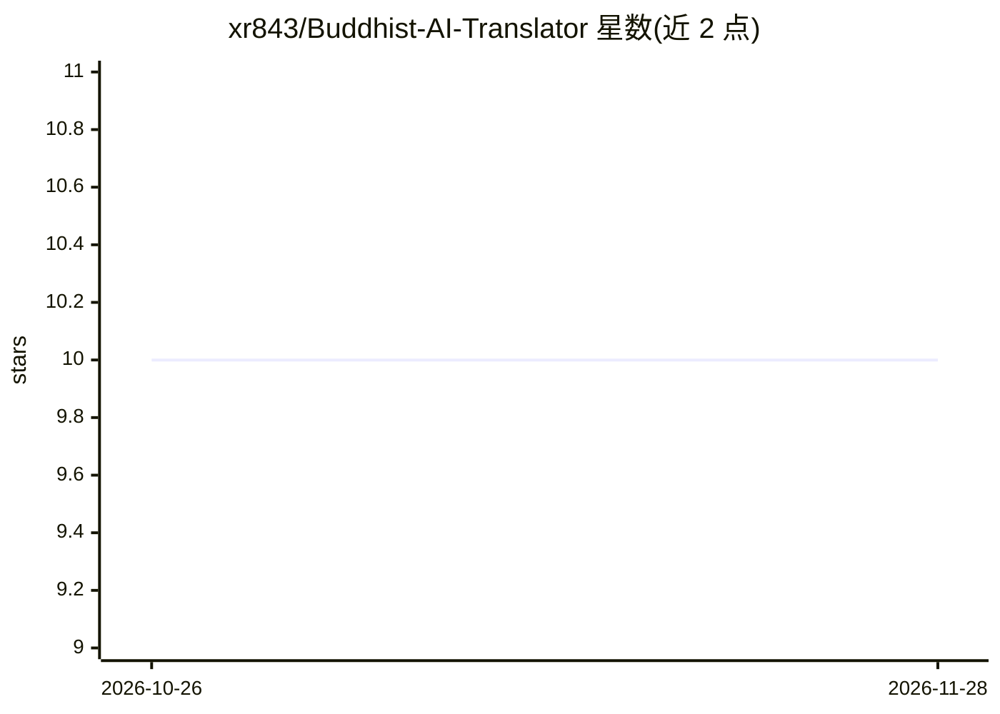

# xr843/Buddhist-AI-Translator

⭐ 10 · JavaScript · MIT · 推送 2026-11-27 · [GitHub](https://github.com/xr843/Buddhist-AI-Translator) · [官网](https://xr843.github.io/Buddhist-AI-Translator) · 个人维护 · 中文 README

**为佛学研究者与修行者翻译梵巴藏汉佛典的 AI 翻译器**

纯前端静态站点形式的佛典翻译平台：默认调用 Dharmamitra 项目的 MITRA 神经翻译引擎（免密钥），覆盖梵／巴／汉／藏及 18 种语言；对 MITRA 不受理的语种对（如译入文言文）可选接入 DeepSeek API，密钥由 Cloudflare Worker 代管或浏览器本地保存。功能包括多本合参、五维译风控制、语音输入与朗读、结果导出、8,610 条术语对照数据（默认不参与翻译，盲评未测出正收益后关闭注入）。自部署需先部署 worker 解决 CORS 问题。

## 筛选速览

| 维度 | 判定 | 备注 |
|---|---|---|
| AI 角色 | `ai-native` | 本体是模型或模型工具 |
| 许可风险 | `permissive` | MIT |
| 部署形态 | `library` | 以包/库形式分发 |
| 模型依赖 | — | README 未给出锁定关系 |
| 硬件要求 | — | 无带数字的原话,不猜 |
| 安装摩擦 | `low` | 无编译、无系统依赖或容器化 |
| 成熟度 | — | 结构信号不足 |

## 能力要点

- 默认 MITRA 神经翻译引擎，佛典语言翻译无需密钥
- 多本合参与五维译风控制组合成模型指令
- 8,610 条汉语术语→梵文原语／藏译对照数据（默认不注入翻译链路）
- 纯前端 ES 模块，任意静态服务器可运行

## 适用场景

- 翻译文言文、梵文、巴利文、藏文佛典为现代语言
- 多语种写本对照后生成一份综合译文
- 查证佛学术语的梵文原语与藏译对应

## 场景标签

`科研工具` · 领域:学习与行业

## 证据(README 行号)

> L16: 慧译通是一款专为佛教文献翻译设计的 AI 翻译平台。默认使用佛典专用的 MITRA 神经翻译引擎
> L35: ||MITRA（默认）|DeepSeek（可选）|

## 星数曲线

2026-10-26 10 → 2026-11-28 10（+0）

---
*卡片 v1 · prompt 1.4 · 生成 2026-11-19 · 置信度 high · 依据 README sha `6b805f32f5c3` · [字段定义](../../DATASET.md)*
