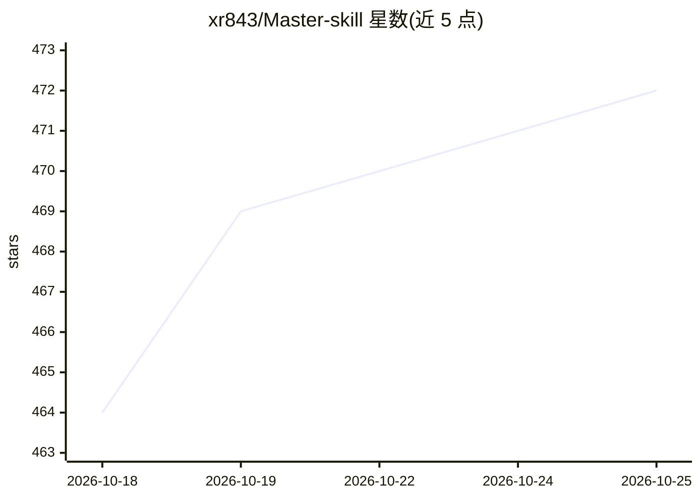

# xr843/Master-skill

⭐ 472 · Python · NOASSERTION · 推送 2026-10-25 · [GitHub](https://github.com/xr843/Master-skill) · [官网](https://fojin.app/chat) · 个人维护 · 中文 README

**佛教 AI 祖师人格框架：16 位祖师对话，回答附原典出处**

由 FoJin 平台驱动的佛教 AI 祖师人格框架，预置印度/汉传/藏传/南传四大传统 16 位祖师及 4 个教学模式（多祖师对比、辩论、学修路径）。每位祖师声明 CBETA/BDRC/Toh/SuttaCentral/PTS 等来源 ID，教义断言强制附原典引证并有离线引文审计；240 条保真度夹具做关键词与引用覆盖检查。普通用户可经 fojin.app/chat 浏览器对话，开发者可经 npx 以 AgentSkills 形式装入 Claude Code、Cursor、Codex CLI、OpenCode、Gemini CLI。评测显示 v1.0 门禁尚未达标。

## 筛选速览

| 维度 | 判定 | 备注 |
|---|---|---|
| AI 角色 | `ai-native` | 本体是模型或模型工具 |
| 许可风险 | `permissive` | NOASSERTION |
| 部署形态 | `library` | 以包/库形式分发 |
| 模型依赖 | — | README 未给出锁定关系 |
| 硬件要求 | — | 无带数字的原话,不猜 |
| 安装摩擦 | `low` | 无编译、无系统依赖或容器化 |
| 成熟度 | `idea` | |

## 能力要点

- 16 位四大传统祖师人格 + 4 个教学模式（对比/辩论/学修路径）
- 教义断言强制附原典出处，附离线引文审计与 240 条保真度夹具
- 接入 FoJin 的 10K+ 文本、678K+ 语义向量与 110K+ 实体知识图谱
- npx 一键安装到 Claude Code / Cursor / Codex CLI / OpenCode / Gemini CLI 五端

## 适用场景

- 以某位祖师的视角提问佛学问题并获得带经号出处的回答
- 跨汉传/藏传/南传比较多位祖师对同一问题的回答
- 按传统获取学修路径或让 AI 推荐该问哪位祖师

## 场景标签

`RAG` `聊天机器人` `科研工具` · 领域:对话与助手

## 证据(README 行号)

> L20:  FoJin 驱动的佛教 AI 祖师人格框架
> L81: Master-skill 是由 FoJin 驱动的佛教 AI 祖师人格框架：以真实原典为来源，以伦理边界为约束，以保真度评测为质量门槛，并以 AgentSkills 运行协议交付给 Claude Code、Cursor、Codex

## 星数曲线

2026-10-18 464 → 2026-10-25 472（+8）

---
*卡片 v1 · prompt 1.4 · 生成 2026-10-21 · 置信度 high · 依据 README sha `845fd07706e2` · [字段定义](../../DATASET.md)*
